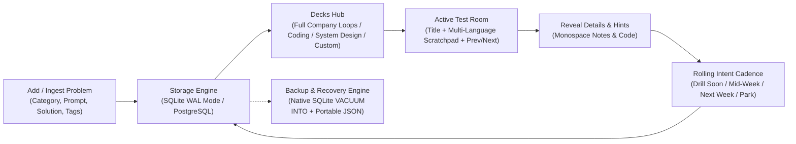

# BrainShuffle

Knowledge retention and active recall platform designed for randomized problem testing, rolling intent-driven review cadences, in-flight company review decks, and multi-language code scratchpad testing.

Full architecture specifications are documented in [docs/DESIGN.md](docs/DESIGN.md).

## 1) Overview

BrainShuffle provides an active recall loop for technical problems across domain categories (`coding`, `system_design`, `llm`, `vlm`). Problems include titles, active recall prompts, hidden solutions/reference notes, subtopic tags, and company associations. Tests present cards with the problem title and an embedded multi-language code scratchpad, prompting recall before revealing hints and reference notes.



### Core Capabilities
- **Decks Hub**: Multi-channel study entry point grouping problems by Full Company Loops, Coding by Company, System Design by Company, and Custom Saved Decks, plus a 1-click Quick Mix Shuffle.
- **Title-First Active Recall**: Problem titles are presented first; active recall prompts and reference notes remain hidden until revealed.
- **Test Session Navigation**: Bidirectional card navigation via Previous and Next controls, keyboard arrow shortcuts (`←` / `→`), and live progress tracking (`Card X of Y`).
- **Multi-Language Code Scratchpad**: CodeMirror 6 editor with AST grammar support for Python 3, TypeScript, JavaScript, C++, Java, Go, Rust, and SQL, native docstrings/multiline comments (`"""`), 4-space Tab indent, smooth height resizing, and ephemeral session persistence (`sessionStorage`).
- **Rolling Review Cadence**: Continuous rolling-window scheduling (`Drill Soon ~4h`, `Mid-Week 2–3d`, `Next Week 7d`, `Skip / Park 21d`) eliminating calendar-boundary resets.
- **Multi-Level Cadence Controls**: Configurable via the Edit Problem dialog, dynamic intent ratings during recall tests, or immediate on-demand review via the Decks Hub.
- **Native SQLite Snapshots & Recovery**: Deterministic zero-lock compaction (`VACUUM INTO`) to canonical storage (`data/backups/brain_shuffle_snapshot.db`) with interactive modal verification and safety rollback copies.
- **Topic Families & Deduplication Guardrails**: Client-side Proximity Radar that detects duplicates and series variants in real time ($0.00 cost) with hierarchical topic family accordions and in-flashcard sibling comparison.
- **Company Decks**: Filter by company across domains and persist custom in-flight review lists to the database.
- **Data Portability**: Collapsible JSON export and import for database backups and cross-machine migrations.

---

## 2) Project Structure

- [pyproject.toml](pyproject.toml): Backend project dependencies and script entrypoints managed by `uv`.
- [docker-compose.yml](docker-compose.yml): Local PostgreSQL database with persistent named volume `postgres_data`.
- [.env.example](.env.example): Environment variable template for database connectivity.
- [docs/DESIGN.md](docs/DESIGN.md): Detailed system design, data schema, Decks Hub, and rolling cadence specifications.
- [docs/SNAPSHOT_ARCHITECTURE_SPEC.md](docs/SNAPSHOT_ARCHITECTURE_SPEC.md): Technical specification for native SQLite snapshots and automated recovery.
- [docs/SUBTEXT_DESIGN.md](docs/SUBTEXT_DESIGN.md): Technical specification for the Subtexts & Idioms track and universal journaling.
- [docs/DIAGRAM_AND_ASSET_DESIGN.md](docs/DIAGRAM_AND_ASSET_DESIGN.md): Technical specification for image pasting, Excalidraw vector canvas, and dual-format storage.
- [docs/TOPIC_GROUPING_AND_DEDUPLICATION_DESIGN.md](docs/TOPIC_GROUPING_AND_DEDUPLICATION_DESIGN.md): Technical specification for topic grouping, zero-cost Proximity Radar, series parsing, and surgical HITL classification.
- [src/brain_shuffle/](src/brain_shuffle/): Python backend application:
  - [src/brain_shuffle/models/](src/brain_shuffle/models/): SQLModel entities (`Category`, `Problem`, `Subtext`, `ReviewList`, `ReviewLog`).
  - [src/brain_shuffle/schemas/](src/brain_shuffle/schemas/): Pydantic validation and serialization schemas.
  - [src/brain_shuffle/api/](src/brain_shuffle/api/): FastAPI REST endpoints for categories, problems, subtexts, companies, review lists, shuffle, and backup.
  - [src/brain_shuffle/services/](src/brain_shuffle/services/): Core logic for rolling intent weighting, native snapshots, and backup serialization.
  - [src/brain_shuffle/cli.py](src/brain_shuffle/cli.py): Command-line tool for snapshotting, data dump, restore, and seeding.
  - [src/brain_shuffle/main.py](src/brain_shuffle/main.py): FastAPI server entrypoint with background snapshot lifecycle worker.
- [frontend/](frontend/): React + TypeScript single-page application built with Vite:
  - [frontend/src/components/ShuffleView.tsx](frontend/src/components/ShuffleView.tsx): Study domain: two-state review workflow (Decks Hub <-> Active Test Room with direct deck deletion).
  - [frontend/src/components/ProblemFlashcard.tsx](frontend/src/components/ProblemFlashcard.tsx): Active recall flashcard component with 3-mode interactive workspace.
  - [frontend/src/components/SubtextFlashcard.tsx](frontend/src/components/SubtextFlashcard.tsx): Active recall flashcard component for the Subtexts & Idioms track.
  - [frontend/src/components/CodeScratchpad.tsx](frontend/src/components/CodeScratchpad.tsx): CodeMirror 6 multi-language editor with OneDark styling, Roboto Mono typography, and font size controls.
  - [frontend/src/components/DualNotepad.tsx](frontend/src/components/DualNotepad.tsx): Single or split two-pane editable notepad with live Markdown preview and quick-action chips.
  - [frontend/src/components/ProblemManager.tsx](frontend/src/components/ProblemManager.tsx): Curate domain: problem inventory, search, filters, non-dismissive editor, and multi-select deck authoring.
  - [frontend/src/components/BackupManager.tsx](frontend/src/components/BackupManager.tsx): Preserve domain: single-card native snapshot manager and JSON portability controls.
  - [frontend/src/indentation.ts](frontend/src/indentation.ts): Centralized IDE-grade tab stop navigation and soft-tab deletion engine.
- [data/backups/](data/backups/): Designated storage directory for canonical snapshots (`brain_shuffle_snapshot.db`) and exports.

---

## 3) Scaffolding & Setup

### Backend (Python + uv)
1. Start the PostgreSQL container (optional; SQLite fallback is automatic):
   ```bash
   docker compose up -d
   ```
2. Initialize the database and seed starter categories and problems:
   ```bash
   uv run brain-shuffle-cli seed
   ```
3. Run the backend development server:
   ```bash
   uv run brain-shuffle
   ```

### Frontend (React + Vite)
```bash
cd frontend
npm install
npm run dev
```

### Data Snapshots & CLI Tooling
```bash
# Take a native SQLite snapshot to canonical storage
uv run brain-shuffle-cli snapshot

# Restore database from canonical snapshot
uv run brain-shuffle-cli restore --snapshot

# Export all problems and categories to a portable JSON file
uv run brain-shuffle-cli dump --output ./data/backups/export.json

# Restore from a portable JSON backup file
uv run brain-shuffle-cli restore --input ./data/backups/export.json
```
