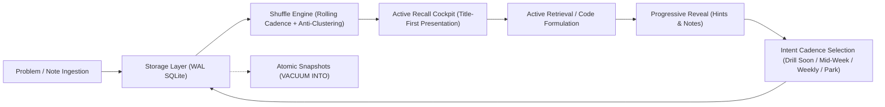
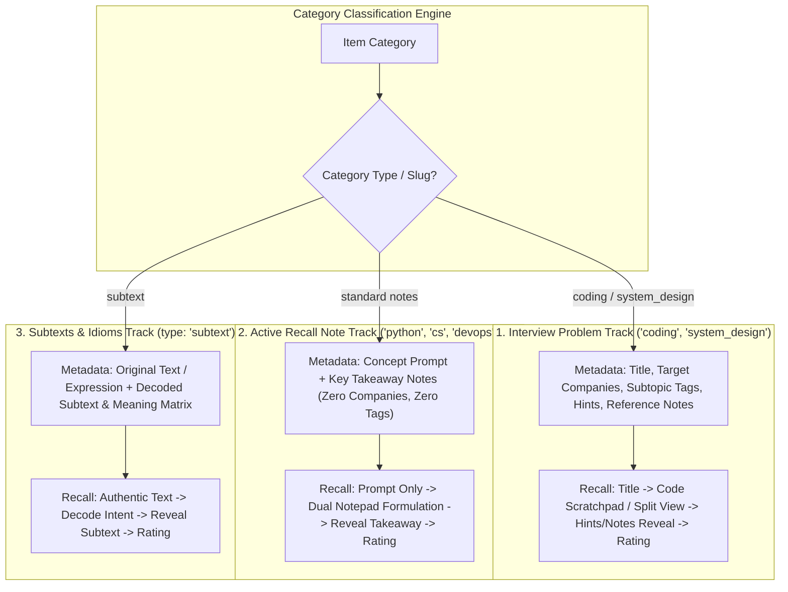
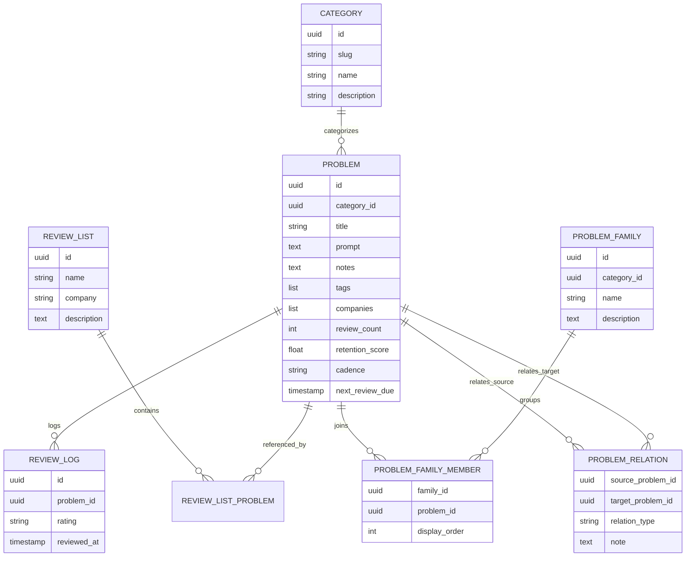
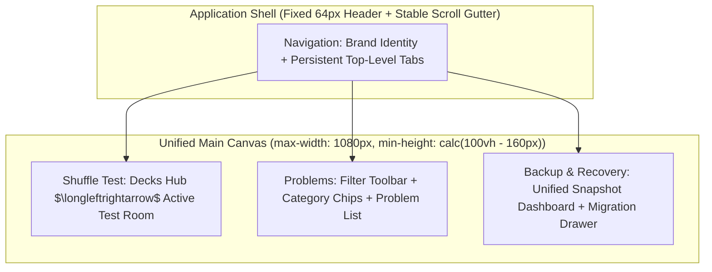
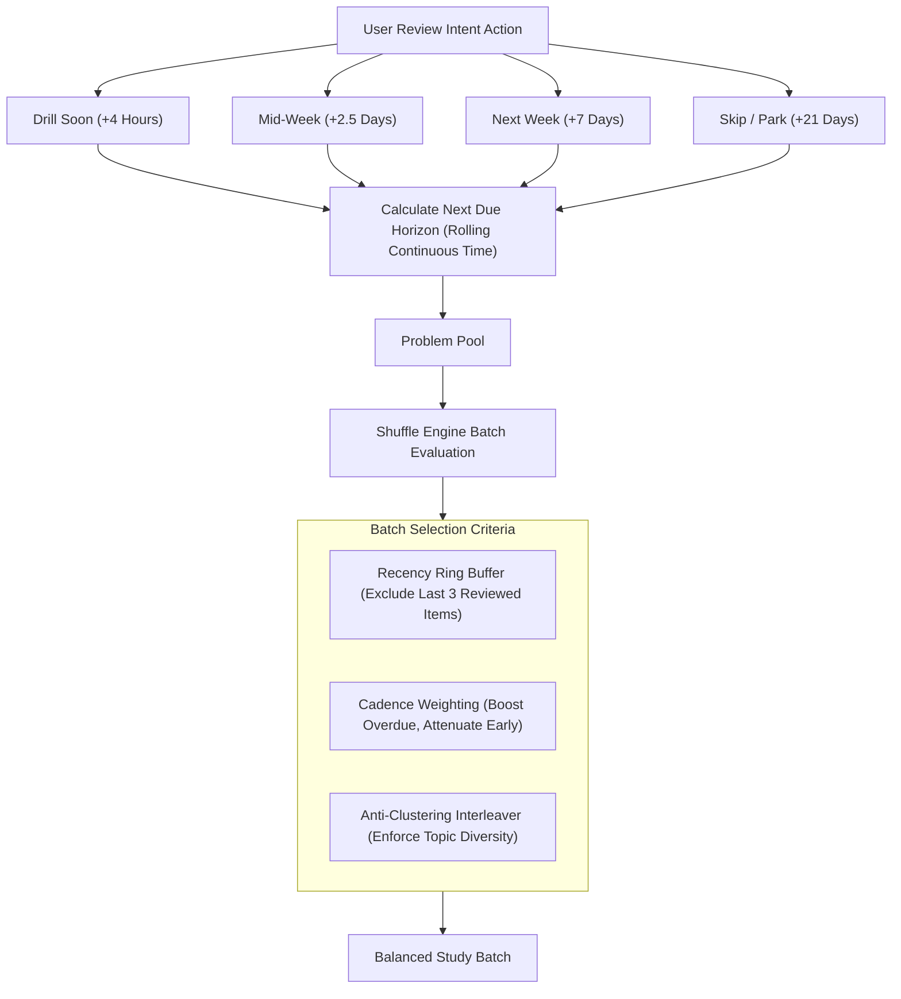
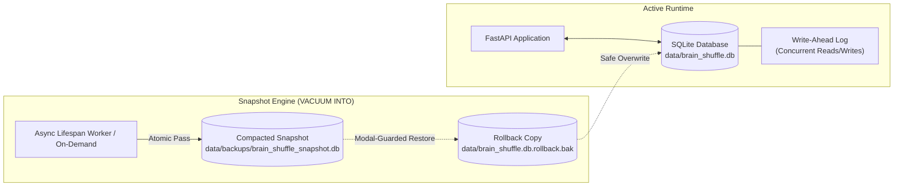

# BrainShuffle Architecture & Design

## 1) Vision & Cognitive Foundation

BrainShuffle is a knowledge retention and active recall platform engineered for software engineers and technical practitioners preparing for technical interviews and domain mastery across computer science and artificial intelligence (`coding`, `system_design`, `python`, `llm`, `vlm`).

### The Limitations of Traditional Spaced Repetition
Traditional spaced repetition software (such as Anki or SuperMemo) was formulated around discrete flashcards (vocabulary, historical facts, medical terms). Applied to software engineering, this paradigm exhibits several structural shortcomings:
- **Passive Recognition Trap**: Presenting a problem with pre-written context prompts the brain to recognize patterns rather than synthesize solutions from first principles.
- **Lack of Coding Formulation**: Engineers must formulate syntax, logic, and architectural trade-offs; reading an answer card does not exercise actual recall.
- **Calendar-Day Debt**: Fixed daily intervals accumulate demoralizing backlogs when a user pauses for several days, leading to review abandonment.
- **Disconnection from Target Domains**: Study in software engineering is contextual (e.g., preparing for an upcoming company interview loop, drilling Python syntax nuances, or studying distributed consensus). Rigid card decks lack dynamic, targeted composition.

### Core Architectural Principles
To solve these limitations, the system establishes four fundamental design principles:

1. **Title-First Active Recall**: Review begins strictly with the problem title or conceptual prompt. All hints, constraints, and solutions remain concealed until the user actively attempts retrieval.
2. **Active Synthesis Workspace**: For interview problems, an embedded multi-language code scratchpad provides a live environment to draft syntax or pseudo-code before revealing answers. For knowledge notes, the interface strips all distractions to present only the core prompt.
3. **Rolling Intent-Driven Cadence**: Reviews are scheduled using forward-looking user intent (`Drill Soon`, `Mid-Week`, `Next Week`, `Skip / Park`) across continuous rolling-time horizons rather than retrospective difficulty scores, eliminating calendar-day backlogs.
4. **On-Demand Targeted Decks**: Problems are tagged with topics and companies, allowing the shuffle engine to dynamically compile company loops, domain tracks, or custom saved decks on demand.

---

## 2) System Model & Knowledge Tracks

The platform organizes learning materials into three specialized tracks, recognizing that algorithmic challenges, conceptual trivia, and nuanced subtexts demand distinct cognitive workflows.

### 1. Tri-Track Specifications
1. **Interview Problem Track** (`coding`, `system_design`):
   - Focuses on complex problems requiring algorithmic synthesis or architecture drafting.
   - Retains interview metadata: associated target companies, algorithmic subtopic tags, progressive hints, and an embedded code editor.
2. **Active Recall Note Track** (`python`, `cs`, `devops`, `ml`, etc.):
   - Focuses on conceptual recall: language syntax nuances, runtime behaviors, gotchas, and definitions.
   - Strips away extraneous fields; the prompt serves as both question and row label.
   - The review experience presents the prompt in isolation, offering dual notepads to type recall notes before revealing the reference answer.
3. **Subtexts & Idioms Track** (category type: `subtext`):
   - Focuses on authentic linguistic nuance, dialogue decoding, business context idioms, and unspoken intent.
   - Pairs unbounded original source text with structured decoded meaning and nuance breakdowns.
   - Distinct flashcard review flow in [frontend/src/components/SubtextFlashcard.tsx](frontend/src/components/SubtextFlashcard.tsx).

### 2. Category Taxonomy & Visual Hierarchy
Categories structure the domain space and provide visual orientation across all views:
- **Title-Cased Normalization**: Category names are normalized to capitalized title case (e.g., `Coding`, `Python`, `System Design`) while preserving technical acronyms (`AWS`, `SQL`, `ML`, `AI`, `OS`).
- **Color-Coded Badges**: Each category receives a dedicated, high-contrast dark-mode palette (e.g., Indigo for Coding, Emerald for Python, Purple for System Design, Cyan for Database/SQL), ensuring instant visual differentiation in lists and flashcards.
- **Relational Integrity**: Category deletion is guarded by reference checks; categories containing existing problems cannot be deleted until those items are reassigned or removed.

### 3. Conceptual Entity Model

---

## 3) User Experience & Workspace Design

The user interface is designed as an application shell that prioritizes stability, visual continuity, and focused ergonomics across its three primary tabs: **Shuffle Test**, **Problems**, and **Backup & Recovery**.

### 1. Unified Application Shell
To eliminate the layout jumps common in single-page applications, the shell enforces strict geometric consistency:
- **Fixed & Sticky Header**: Pinned at `top: 0` with dark glassmorphism and a fixed 64px height. Navigation tabs remain accessible from any scroll position.
- **Stable Scrollbar Gutter**: Configured with `scrollbar-gutter: stable`, permanently reserving browser scrollbar space to prevent 15px horizontal shifts between tall and short views.
- **Consistent Canvas Dimensions**: All views render within a shared container enforcing a `1080px` maximum width and a minimum viewport height (`min-height: calc(100vh - 160px)`), eliminating vertical bounce when switching tabs.

### 2. Shuffle Test & Decks Hub
The review workspace ([frontend/src/components/ShuffleView.tsx](frontend/src/components/ShuffleView.tsx)) operates as a dual-state cockpit:
- **State A (Decks Hub)**: The landing interface organizes review items into dedicated channels:
  - **Topics & Categories**: Dedicated decks for all domain categories (`Python Deck`, `Coding Deck`, etc.) distinguishing note tracks from problem tracks.
  - **Full Company Loops**: Aggregates all problems associated with specific employers (e.g., Google Full Loop, Amazon Full Loop).
  - **Coding by Company**: Focuses exclusively on algorithms and data structures filtered by target company.
  - **System Design by Company**: Focuses on architecture and distributed systems challenges.
  - **Custom Saved Decks**: Targeted study decks curated directly by the user.
  - **Quick Mix Shuffle**: A universal one-click action that draws a 5-item cross-topic drill.
- **State B (Active Testing Room)**: Presents problems sequentially in [frontend/src/components/ProblemFlashcard.tsx](frontend/src/components/ProblemFlashcard.tsx):
  - Card counter (`Card X of Y`) and session reviewed badge.
  - Bidirectional navigation via header controls or keyboard shortcuts (`ArrowLeft` / `ArrowRight`), automatically bypassing shortcut listeners when typing in code editors or inputs.
  - Immediate exit breadcrumb (`← Decks`) returning to the hub.

### 3. Problem Curation & Multi-Select Deck Building
The curation interface ([frontend/src/components/ProblemManager.tsx](frontend/src/components/ProblemManager.tsx)) combines LeetCode-style efficiency with custom deck compilation:
- **Compact List Rows**: Each row displays an item selection checkbox, color-coded category badge, title, quick actions (edit, delete), and an expansion toggle.
- **Topic Family Grouping View**: An alternate display mode groups problems into hierarchical family accordions (e.g. `k-Sum Series`, `Monotonic Stack Pattern`), allowing related variations to be browsed, selected, or drilled together.
- **In-Place Recall**: Expanding any row mounts the active recall card directly within the list, allowing quick review without navigating away.
- **Multi-Select Deck Authoring**: Selecting multiple problem checkboxes reveals a floating action bar to save the selection as a persistent custom deck or update review cadences in bulk.
- **Proximity Radar & Duplicate Prevention**: The problem creation dialog runs a real-time, client-side heuristic engine that flags potential duplicates and identifies series variants (e.g. linking `3Sum` to `Two Sum`) as the operator types, requiring zero external API calls.
- **Non-Dismissive Modal Dialogs**: Creation and editing modals require explicit confirmation (`Save` or `Cancel`), preventing accidental dismissal on backdrop clicks. Textareas support automatic indentation on `Enter` and 4-space indentation on `Tab`.

### 4. Interactive Unified Workspaces & Indentation Engine
The active recall interface provides a flexible three-mode workspace directly inside [frontend/src/components/ProblemFlashcard.tsx](frontend/src/components/ProblemFlashcard.tsx):
- **Workspace Layout Modes**:
  1. `Code Only`: Dedicated CodeMirror 6 scratchpad for syntax synthesis and algorithmic drafting.
  2. `Split View (Code + Notes)`: Resizable horizontal split view pairing the code scratchpad on the left with dual notes on the right.
  3. `Scratch Notes Only`: Full-width note workspace for jotting conceptual bullets, edge cases, and callouts.
- **Dual Notepad (`DualNotepad.tsx`)**:
  - Supports single-column or split 2-column editable notepads with synchronized markdown previews.
  - Quick-action chips for rapid formatting: `List`, `Code` (with language selector), `Callout`, and `Clear`.
- **IDE-Grade Code Scratchpad (`CodeScratchpad.tsx`)**:
  - Built on CodeMirror 6 with the OneDark theme and Roboto Mono typography.
  - Dynamic language selector supporting 10 languages (Python, TypeScript, JavaScript, C++, Java, Go, Rust, SQL, JSON, Text).
  - Integrated font size adjustment controls (`A- / A+`) stepping between 11px and 20px.
- **Centralized Indentation Engine (`frontend/src/indentation.ts`)**:
  - Implements VS Code / Monaco tab stop behavior (`editor.useTabStops: true`):
    - `Tab`: Advances cursor to the next 4-space tab stop (`4 - (col % 4)`); indents whole selections when text is highlighted.
    - `Backspace`: Deletes backward to the previous 4-space tab stop in a single stroke when preceded by spaces (`toDelete > 1`).
    - `changeByRange`: Ensures atomic cursor tracking and selection maintenance in CodeMirror transactions.
    - Modifier key filtering: Preserves browser shortcuts (`Ctrl+Tab`, `Cmd+Tab`) and OS line/word deletions (`Cmd+Backspace`, `Option+Backspace`).

---

## 4) Rolling Cadence & Shuffle Engine

The platform replaces traditional calendar-date algorithms with an intent-driven rolling cadence engine implemented in [src/brain_shuffle/services/shuffle_engine.py](src/brain_shuffle/services/shuffle_engine.py).

### 1. Rolling Action Horizons
Instead of grading memory on a 1-to-5 scale, users declare forward-looking intent:

| Action Intent | Target Cadence | Rolling Horizon | Next Due Interval | Purpose |
| :--- | :--- | :--- | :--- | :--- |
| 🔄 **Drill Soon** | `daily` | Rolling Intra-Day | $+4\text{ hours}$ | Concepts missed or requiring immediate same-day drill |
| 📅 **Mid-Week** | `intra_week` | Rolling Intra-Week | $+60\text{ hours}$ (2.5d) | Near-term consolidation for tricky problems |
| 🗓️ **Next Week** | `weekly` | Rolling Weekly | $+168\text{ hours}$ (7d) | Standard weekly active recall maintenance |
| ⏭️ **Skip / Park** | `monthly` | Rolling Deferred | $+504\text{ hours}$ (21d) | Well-mastered items or low-priority edge cases |

Because due dates are relative to the timestamp of the last review attempt, pausing practice for several days does not create an artificial backlog of hundreds of overdue cards.

### 2. Candidate Selection & Priority Boosting
When constructing a review batch, the engine evaluates candidates using three rules:
1. **Recency Buffer**: Excludes the last 3 reviewed items to eliminate immediate repeats within a study session.
2. **Unreviewed Priority**: Newly ingested items that have never been tested receive a priority boost to ensure prompt initial review.
3. **Overdue Escalation vs. Cooldown Attenuation**:
   - Items whose due dates have passed receive priority boosts scaled to how long they have been due.
   - Items still in their cooldown windows have their selection probability significantly reduced, preventing over-testing.

### 3. Topic Interleaving & Anti-Clustering
To prevent cognitive priming (e.g., solving three tree recursion problems in a row, which tips off the solution method), the engine applies interleaving:
- **Topic Signature**: Inspects tags, category domains, and keywords.
- **Anti-Clustering Penalty**: Successive cards with overlapping tags receive selection penalties. The sequence dynamically alternates between algorithms, architectures, and language concepts to enforce varied practice.
- **Targeted Family Drill Override**: When initiating a focused session for a specific Topic Family or custom review list (e.g., drilling the `k-Sum Series`), the anti-clustering penalty is suspended, allowing intentional sequential recall of related algorithmic variations.

---

## 5) Persistence, Snapshots & Data Reliability

The system uses a local-first storage architecture designed for speed, zero-friction maintenance, and resilience against data corruption.

### 1. Persistence Engine & Concurrency
- **Primary Engine**: Embedded SQLite at [data/brain_shuffle.db](data/brain_shuffle.db), with optional containerized PostgreSQL fallback configured via [docker-compose.yml](docker-compose.yml).
- **Write-Ahead Logging (WAL)**: Initialized with `PRAGMA journal_mode=WAL` and `PRAGMA synchronous=NORMAL`. Readers never block writers and writers never block readers, allowing background snapshots to proceed without interrupting live user study.
- **Busy Timeout**: Configured with a 5-second busy timeout to eliminate lock contention.

### 2. Native Compacting Snapshots (`VACUUM INTO`)
Rather than relying on brittle text serialization, backups leverage SQLite's native atomic `VACUUM INTO` command:
- **Atomic File Creation**: The snapshot engine creates a defragmented, byte-level copy of the database at [data/backups/brain_shuffle_snapshot.db](data/backups/brain_shuffle_snapshot.db) in an isolated read transaction.
- **Page Defragmentation**: Reclaims space from deleted problems and re-indexes B-trees into a contiguous file.
- **Zero-Friction Operations**: Backups happen without file dialogs or manual exports.

### 3. Automated Lifecycle & Safety Guardrails
- **Heartbeat Worker**: A background task evaluates database modifications every 30 minutes. If changes have occurred since the last snapshot, a new snapshot is taken automatically.
- **Shutdown Persistence**: Process termination hooks take an immediate snapshot upon server shutdown.
- **Restoration Safety**:
  - Restoring a snapshot requires confirmation through a guarded modal dialog in [frontend/src/components/BackupManager.tsx](frontend/src/components/BackupManager.tsx).
  - Prior to restoration, an automatic rollback copy (`data/brain_shuffle.db.rollback.bak`) is created. If the snapshot is corrupt, the system reverts automatically.
- **Secondary JSON Portability**: A collapsible portability drawer provides JSON export and import for transferring libraries between different operating systems or machines.

---

## 6) Subsystem Specifications & Deep Dives

Detailed technical designs and implementation specifications for platform subsystems are maintained in dedicated documents:
- [SNAPSHOT_ARCHITECTURE_SPEC.md](SNAPSHOT_ARCHITECTURE_SPEC.md): Native SQLite snapshot engine, WAL concurrency, automated lifespan rotation, and three-stage rollback recovery.
- [SUBTEXT_DESIGN.md](SUBTEXT_DESIGN.md): Subtext and idioms track, unbounded text containment, dialogue decoding, and nuance matrix presentation.
- [DIAGRAM_AND_ASSET_DESIGN.md](DIAGRAM_AND_ASSET_DESIGN.md): Clipboard image pasting, Excalidraw vector canvas integration, dual `scene_json` / `svg_data` storage, full-screen Zen overlay, and SQLite BLOB persistence.
- [TOPIC_GROUPING_AND_DEDUPLICATION_DESIGN.md](TOPIC_GROUPING_AND_DEDUPLICATION_DESIGN.md): Topic family grouping, zero-cost client-side Proximity Radar, series variant parsing, and surgical human-in-the-loop (HITL) classification.
