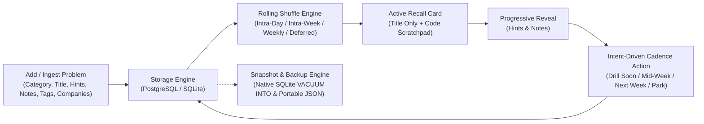
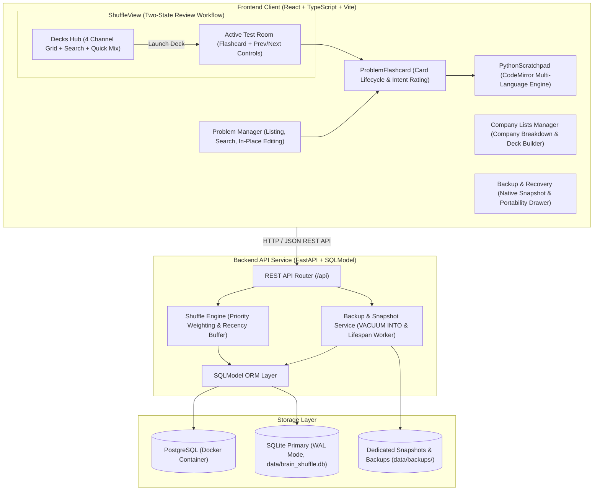
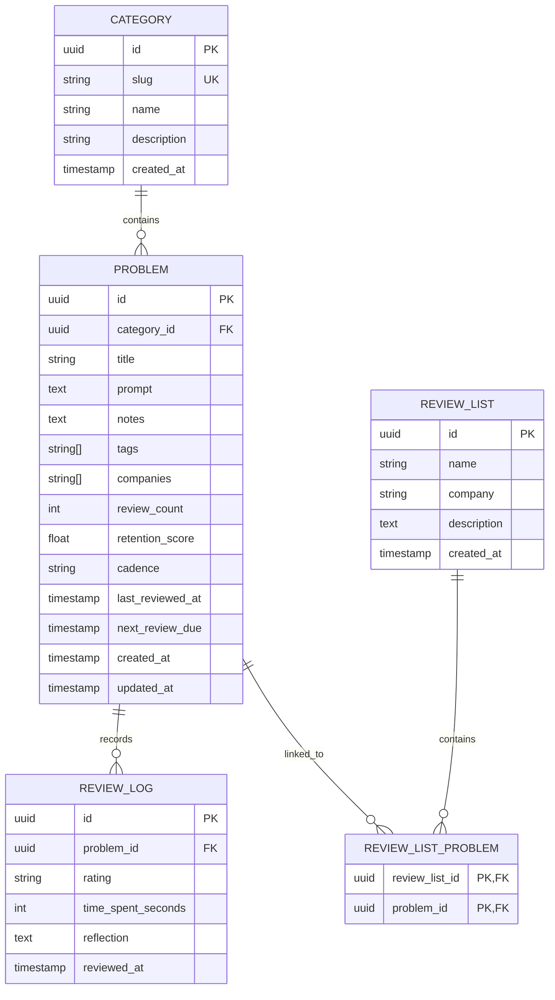
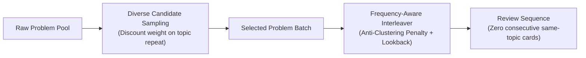
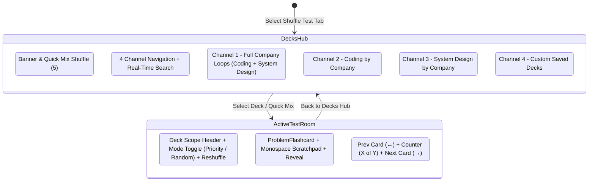
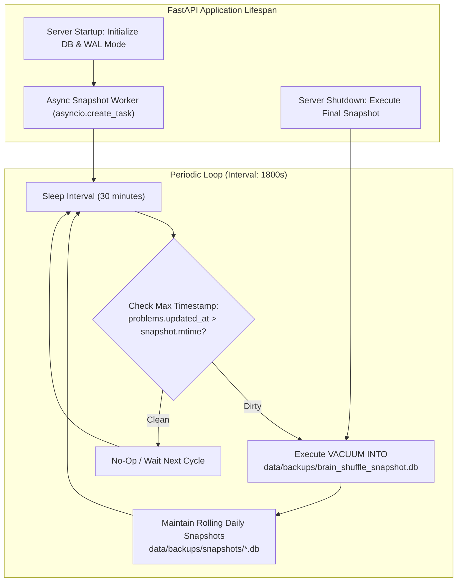

# System Design Specification: Brain Shuffle

## 1) System Overview & Core Philosophy

Brain Shuffle is a knowledge retention and active recall platform designed for technical problem review across computer science and artificial intelligence domains (`coding`, `system_design`, `llm`, `vlm`).

The system departs from rigid historical flashcard paradigms (such as fixed SuperMemo or Anki scheduling) by enforcing four core design principles:
1. **Title-First Active Recall**: Problems are introduced exclusively by title. Retrieval prompts and reference solutions remain hidden, challenging the user to reconstruct solutions and architecture from the problem label alone.
2. **Multi-Language Code Scratchpad**: Users formulate code or pseudo-code directly in an embedded CodeMirror editor before revealing solutions, validating actual recall rather than passive recognition.
3. **Rolling Intent-Driven Cadence**: Reviews are scheduled on continuous rolling-time horizons determined by forward-looking user intent (`drill_soon`, `intra_week`, `weekly`, `skip_park`) rather than retrospective difficulty scores.
4. **Company-Targeted Study Decks**: Problems can be filtered and clustered by target companies, allowing on-demand compilation and persistence of focused review decks.



---

## 2) System Architecture & Component Roles

The platform follows a decoupled client-server architecture consisting of a Python backend service, a single-page React frontend, and a dual-mode persistence layer.



### Component Responsibilities
- **Backend Service** ([src/brain_shuffle/](src/brain_shuffle/)): Python application managed via `uv`. Uses FastAPI for RESTful routing, SQLModel for ORM entity mapping, and Pydantic for input validation and serialization.
- **Frontend Client** ([frontend/](frontend/)): Single-page application built with React 19, TypeScript, and Vite. Organized into three focused domains:
  - **Shuffle Test (Study)** ([frontend/src/components/ShuffleView.tsx](frontend/src/components/ShuffleView.tsx)): Two-state review workflow transitioning between an entry Decks Hub (Company Loops, Coding Tracks, System Design Tracks, Custom Saved Decks with direct deletion) and an active testing room with bidirectional navigation.
  - **Problems (Curate)** ([frontend/src/components/ProblemManager.tsx](frontend/src/components/ProblemManager.tsx)): Problem inventory, search, category filters, non-dismissive editing modal, and multi-select deck authoring for creating targeted review lists directly from filtered problem sets.
  - **Backup & Recovery (Preserve)** ([frontend/src/components/BackupManager.tsx](frontend/src/components/BackupManager.tsx)): Single unified dashboard for native SQLite snapshots (`VACUUM INTO`), live file metrics, modal-guarded recovery, and collapsible JSON portability.
- **Storage Layer**: Default configuration uses local SQLite at [data/brain_shuffle.db](data/brain_shuffle.db) with WAL mode enabled, with containerized PostgreSQL fallback available through [docker-compose.yml](docker-compose.yml).
- **Serialization & Snapshot Engine** ([src/brain_shuffle/services/backup_service.py](src/brain_shuffle/services/backup_service.py)): Manages native zero-lock SQLite snapshots and secondary JSON export/import.

---

## 3) Data Model & Schema Specifications

The schema organizes learning resources hierarchically under domain categories, links problems to review histories, and provides many-to-many associations for custom review decks.



### Table Definitions

#### `categories`
| Column | Type | Constraints | Description |
|---|---|---|---|
| `id` | UUID | Primary Key | Unique category identifier |
| `slug` | VARCHAR(64) | Unique, Indexed | Short URL-friendly key (`coding`, `system_design`, `llm`, `vlm`) |
| `name` | VARCHAR(128) | Not Null | Display name (e.g. "Coding", "Large Language Models") |
| `description` | TEXT | Nullable | Domain description |
| `created_at` | TIMESTAMPTZ | Not Null | Creation timestamp |

#### `problems`
| Column | Type | Constraints | Description |
|---|---|---|---|
| `id` | UUID | Primary Key | Unique problem identifier |
| `category_id` | UUID | Foreign Key -> `categories.id` | Associated domain category |
| `title` | VARCHAR(256) | Not Null, Indexed | Problem title (e.g. "Dynamic Programming: 0/1 Knapsack") |
| `prompt` | TEXT | Not Null | Active recall hints, constraints, and problem details |
| `notes` | TEXT | Not Null | Reference notes, key insights, and solution code |
| `tags` | JSON / ARRAY | Not Null | Subtopic tags (e.g. `["dp", "knapsack", "optimization"]`) |
| `companies` | JSON / ARRAY | Not Null | Associated companies (e.g. `["Google", "Meta", "Amazon"]`) |
| `review_count` | INTEGER | Default `0` | Total review attempts |
| `retention_score` | FLOAT | Default `1.0` | Recall stability score |
| `cadence` | VARCHAR(32) | Default `'weekly'` | Target cadence: `daily`, `intra_week`, `weekly`, `monthly` |
| `last_reviewed_at` | TIMESTAMPTZ | Nullable | Timestamp of most recent attempt |
| `next_review_due` | TIMESTAMPTZ | Nullable | Next calculated rolling review due date |
| `created_at` | TIMESTAMPTZ | Not Null | Creation timestamp |
| `updated_at` | TIMESTAMPTZ | Not Null | Timestamp of last modification |

#### `review_lists`
| Column | Type | Constraints | Description |
|---|---|---|---|
| `id` | UUID | Primary Key | Unique review list identifier |
| `name` | VARCHAR(128) | Not Null | Review list title |
| `company` | VARCHAR(128) | Nullable | Associated target company |
| `description` | TEXT | Nullable | Optional deck description |
| `created_at` | TIMESTAMPTZ | Not Null | Creation timestamp |

#### `review_list_problems`
| Column | Type | Constraints | Description |
|---|---|---|---|
| `review_list_id` | UUID | Foreign Key -> `review_lists.id` | Reference to parent review list |
| `problem_id` | UUID | Foreign Key -> `problems.id` | Reference to included problem |

#### `review_logs`
| Column | Type | Constraints | Description |
|---|---|---|---|
| `id` | UUID | Primary Key | Review attempt record |
| `problem_id` | UUID | Foreign Key -> `problems.id` | Subject problem |
| `rating` | VARCHAR(32) | Not Null | Action intent: `drill_soon`, `intra_week`, `weekly`, `skip_park` |
| `time_spent_seconds`| INTEGER | Nullable | Duration spent thinking before reveal |
| `reflection` | TEXT | Nullable | Brief user notes on failure or takeaway |
| `reviewed_at` | TIMESTAMPTZ | Not Null | Event timestamp |

### Validation & Normalization Rules
1. **Company Normalization**: Ingested company names are trimmed and normalized by title-casing the first letter of each word while preserving interior casing (e.g. `google` $\to$ `Google`, `two sigma` $\to$ `Two Sigma`, `bytedance` $\to$ `ByteDance`). De-duplication is enforced case-insensitively.
2. **Tag Preservation**: Subtopic tags are trimmed and de-duplicated while preserving exact user casing (e.g. `twoPointers`, `DP`, `graphBFS`).
3. **Cascade Deletes**: Deleting a problem automatically cascades to delete associated `review_logs` and entries in `review_list_problems`.

---

## 4) Rolling Intent-Driven Cadence & Shuffle Algorithm

The review scheduler operates on continuous rolling time relative to each problem's `last_reviewed_at` and `next_review_due`, eliminating calendar-boundary resets.

### 1. Rolling Action Intents

| Action Intent | Canonical Cadence | Rolling Horizon | Next Due Interval | Cooldown Window | Intended Usage |
|---|---|---|---|---|---|
| 🔄 **Drill Soon** | `daily` | Rolling Intra-Day | $+4\text{ hours}$ | $2\text{ hours}$ | Critical concepts needing same-day repetition |
| 📅 **Mid-Week** | `intra_week` | Rolling Intra-Week | $+60\text{ hours}$ (2.5d) | $36\text{ hours}$ | 48h–72h consolidation checkpoint |
| 🗓️ **Next Week** | `weekly` | Rolling Weekly | $+168\text{ hours}$ (7d) | $5\text{ days}$ | Standard weekly review cycle |
| ⏭️ **Skip / Park** | `monthly` | Rolling Deferred | $+504\text{ hours}$ (21d) | $14\text{ days}$ | Park low-priority or draining edge cases |

### 2. Candidate Selection Probability

When drawing a batch of candidate problems, candidate sampling weight $W$ is calculated as:

$$W = \mathbb{I}(\text{not in recency ring buffer}) \times \left( W_{\text{base}} + W_{\text{new}} + W_{\text{cadence\_boost}} + W_{\text{overdue}} \right)$$

Where:
- **Base Weight** ($W_{\text{base}} = 1.0$): Guarantees that any problem in the pool remains eligible for review at any time.
- **Recency Ring Buffer**: Excludes the immediate last $K=3$ reviewed problem IDs to prevent consecutive repeats within the same session.
- **Unreviewed Ingestion Bonus** ($W_{\text{new}}$): Problems without prior review history receive $W_{\text{new}} = +9.0$, ensuring newly ingested problems surface promptly.
- **Cooldown Attenuation**: When the current time is prior to `next_review_due` ($\text{now} < \text{next\_review\_due}$):
  - For `daily` cadence: weight is scaled to $0.5$.
  - For `intra_week`, `weekly`, or `monthly`: weight is attenuated to $0.1$.
- **Overdue Escalation**: Once $\text{now} \ge \text{next\_review\_due}$:
  - Cadence boost ($W_{\text{cadence\_boost}}$) is applied: $+8.0$ for `daily`, $+6.0$ for `intra_week`, $+4.0$ for `weekly`.
  - Overdue time bonus is added:
    $$W_{\text{overdue}} = \min\left(8.0, \; \frac{\text{overdue\_hours}}{24.0} \times 1.5\right)$$

Weighted random sampling without replacement selects candidates from the evaluated pool until the batch limit is fulfilled.

### 3. Topic Interleaving & Anti-Clustering Layout

To prevent blocked practice and cognitive priming during active recall sessions, the shuffle engine enforces topic interleaving:



#### Topic Signature Extraction
For each problem $p$, the engine extracts:
1. **Normalized Exact Tags**: Lowercase, trimmed, punctuation-unified tag tokens (e.g. `"two-pointers"` $\to$ `"two pointers"`).
2. **Subtopic Tokens**: Word-level stems across tags (e.g. `"pointers"` in `"two pointers"` and `"fast/slow pointers"`).
3. **Category Scope**: `category_id` representing the high-level domain (`coding`, `system_design`, `llm`, `vlm`).

#### Topic Collision Penalty Metric
Between any two problems $A$ and $B$, topic collision penalty $S(A, B)$ is evaluated as:
- **Exact Tag Collision**: $+1000 \times |Tags_A \cap Tags_B|$ (highest penalty; strict separation).
- **Subtopic Token Collision**: $+250 \times |Tokens_A \cap Tokens_B|$ (secondary penalty for related techniques).
- **Domain Category Collision**: $+50$ when belonging to the same domain (ensures balanced domain rotation in cross-topic decks).

#### Dynamic Topic Diversity Sampling
When drawing a subset of $M$ problems from candidate pool $P$, candidate weight is dynamically discounted as problems are selected:
$$W_{\text{effective}}(c) = \frac{W(c)}{1.0 + \sum_{s \in \text{Selected}} S(c, s) / 250.0}$$
This guarantees diverse topic coverage across the drawn batch.

#### Frequency-Aware Anti-Clustering Interleaving
To prevent greedy starvation where high-frequency topics clump at the end of a session, problems are arranged dynamically:
1. The interleaver tracks a 3-card lookback window:
   $$\text{Penalty}(c) = S(c, O_{-1}) + 0.3 \times S(c, O_{-2}) + 0.1 \times S(c, O_{-3})$$
2. Ties in minimal overlap are resolved by choosing candidates with higher remaining frequency ($\text{rem\_freq}$), distributing dominant topics evenly across the deck.
3. If an initial predecessor is known from the prior batch, the first card of the new batch is chosen to avoid the preceding topic, ensuring smooth inter-batch transitions.

---

## 5) Active Recall Workspace & Flashcard Ergonomics

The active recall interface is implemented in [frontend/src/components/ProblemFlashcard.tsx](frontend/src/components/ProblemFlashcard.tsx) and [frontend/src/components/PythonScratchpad.tsx](frontend/src/components/PythonScratchpad.tsx).

### 1. Title-First Card Presentation
- Cards display only category tag, review statistics, and problem title upon initial load.
- Problem hints, constraints, and solutions remain unmounted or hidden to prevent passive recognition.

### 2. Multi-Language Code Scratchpad
- **Editor Engine**: CodeMirror 6 via `@uiw/react-codemirror`, replacing dual `<pre>` / `<textarea>` DOM overlays with a single unified, performant, AST-aware editor surface.
- **Supported Languages**: Multi-language dropdown selector with persistence in `localStorage` (`preferred_scratchpad_language`), offering AST parsing and grammar highlights for:
  - Python 3 (`@codemirror/lang-python` with automatic colon indentation and docstring handling)
  - TypeScript & JavaScript (`@codemirror/lang-javascript` with TSX and JSX extensions)
  - C++ (`@codemirror/lang-cpp`)
  - Java (`@codemirror/lang-java`)
  - Go (`@codemirror/lang-go`)
  - Rust (`@codemirror/lang-rust`)
  - SQL (`@codemirror/lang-sql`)
- **Quote Pairing & Multiline Comments**: AST-aware bracket matching and quote closing natively supports nested quotes and multiline comments/docstrings (`"""` and `'''`), resolving cursor trapping and unwanted character duplication.
- **Viewport Dimensions & Geometry**:
  - Baseline height configured at **380px** (accommodating 18–22 visible lines).
  - Maximum container width bounded to **920px** with margin centering.
  - Interactive bottom drag handle bar (`.scratchpad-resize-bar`) permitting smooth vertical resizing between 260px and 820px, with user preferences persisted in `localStorage` (`preferred_scratchpad_height`).
- **Indentation & Keymaps**: Configured with `indentUnit.of("    ")` and `indentWithTab` from `@codemirror/commands` for tab insertion, block indentation, dedentation, and auto-indent on newline.
- **Theme & Dark Palette**: Customized CodeMirror theme and `@codemirror/theme-one-dark` conforming to `--bg-primary` (`#090d16`), `--border-color` (`#1e293b`), and `#38bdf8` accent carets.
- **Ephemeral Session Storage**: Draft code persists in browser `sessionStorage` under `session_scratch_{problem_id}` across card navigations, without persisting to the backend database.
- **Quick Actions**: One-click clipboard copy with status feedback, line count pill, and a session clear action.

### 3. Minimalist Progressive Reveal
- **Disclosure Controls**: Two compact toggle buttons labeled **Hints** and **Notes** disclose problem details and reference solutions on demand.
- **Indented Typography**: Revealed sections configure `white-space: pre-wrap;` and `tab-size: 4;`. The notes section uses monospace typography (`ui-monospace`), ensuring vertical character alignment for indented code blocks, pseudo-code, and tabular data.

### 4. Low-Saturation Cadence Action Row
- **Single-Line Layout**: Replaces large block buttons with a streamlined single-tier horizontal row (`.cadence-action-row`).
- **Low-Saturation Tinting**: Replaces solid color blocks with translucent fills (`rgba(..., 0.08)`), low-contrast borders (`rgba(..., 0.28)`), and pastel typography.
- **Micro-Chips**: Displays horizon windows concisely (`~4h`, `2–3d`, `7d`, `21d`) alongside action titles.

### 5. Session Navigation & Keyboard Ergonomics
- **Directional Navigation Controls**:
  - **Previous Problem**: Left Arrow key (`ArrowLeft`) and top-right `< Prev` card control.
  - **Next Problem**: Right Arrow key (`ArrowRight`) and top-right `Next >` card control.
  - **Exit Deck**: Streamlined breadcrumb return button (`← Decks`) in `.active-session-breadcrumb-bar`.
- **Input Field Awareness**: Global keyboard listeners check `document.activeElement` and bypass shortcut execution when active inside `<input>`, `<textarea>`, or contentEditable fields (such as the CodeMirror editor).
- **Session Progress & Telemetry**:
  - Displays card position indicator (`Card X of Y`) alongside session review count badge (`✓ N`).
  - Streamlined breadcrumb header (`.active-session-breadcrumb-bar`) houses `← Decks / Deck Title`, compact mode toggle (`Priority` vs `Random`), and `Reshuffle`.

---

## 6) Problem Management, Mutation & Deck Workflows

### 1. Shuffle Test Decks Hub Architecture
The primary entry interface for test sessions ([frontend/src/components/ShuffleView.tsx](frontend/src/components/ShuffleView.tsx)) operates as a two-state workflow:



#### Dual-State Controller
1. **State A: Decks Hub**:
   - Serves as the landing view for the Shuffle Test tab.
   - Categorizes problems into four dedicated review channels:
     - **Full Company Loops**: Aggregates all problems associated with a target company across Coding, System Design, and AI domains. Each card provides domain breakdowns and granular launch buttons (`Test All`, `Coding`, `System Design`).
     - **Coding by Company**: Groups algorithm and data structure problems (`coding` category) by company, displaying targeted problem count chips.
     - **System Design by Company**: Groups architecture, scalability, and distributed systems challenges (`system_design` category) by company.
     - **Custom Saved Decks**: Displays user-curated study lists stored in `review_lists` with custom names, company tags, and card count badges.
   - **Quick Mix Shuffle**: A universal one-click action in the hub banner launching a 5-problem cross-topic randomized recall drill.
   - **Live Search Filtering**: An integrated search bar enables instant client-side filtering across company names and deck titles.
2. **State B: Active Test Room**:
   - Activated upon selecting any deck or triggering Quick Mix.
   - Loads a scoped batch via `fetchShuffleBatch` matching the deck's `categoryId`, `company`, or `reviewListId`.
   - Mounts [frontend/src/components/ProblemFlashcard.tsx](frontend/src/components/ProblemFlashcard.tsx) with persistent index tracking, rating submission, and automatic advancement.

### 2. Cadence & Review Frequency Configuration Points
The platform provides three distinct mechanisms to adjust review cadences and study frequency:
1. **Per-Problem Explicit Cadence**:
   - Within [frontend/src/components/ProblemManager.tsx](frontend/src/components/ProblemManager.tsx), opening the Edit Problem modal provides a "Target Review Cadence" selector.
   - Configures a problem's default schedule to `daily` (~4h), `intra_week` (2–3d), `weekly` (7d), or `monthly` (21d).
2. **Dynamic Rolling Horizon Evaluation**:
   - During active testing in [frontend/src/components/ProblemFlashcard.tsx](frontend/src/components/ProblemFlashcard.tsx), selecting an intent rating (`Drill Soon`, `Mid-Week`, `Next Week`, `Skip / Park`) recalculates `next_review_due` and updates the problem's active cadence and review count upon submission to `POST /api/problems/{id}/review`.
3. **Immediate On-Demand Deck Execution**:
   - Selecting any company track or custom deck in the Decks Hub instantly loads and reviews problems on demand, allowing targeted drill passes regardless of scheduled due dates.

### 3. In-Place Problem Editing
Problems can be updated via the frontend interface ([frontend/src/components/ProblemManager.tsx](frontend/src/components/ProblemManager.tsx)) and the REST API:
- **API Endpoint**: `PUT /api/problems/{problem_id}` in [src/brain_shuffle/api/problems.py](src/brain_shuffle/api/problems.py) accepts `ProblemUpdate` payloads, enabling modification of title, category reclassification (`category_id`), prompt, notes, companies, tags, and cadence.
- **Audit Timestamp**: The backend automatically updates `problem.updated_at = datetime.now(timezone.utc)` upon committing changes.
- **Access Points**: Triggered from the pencil icon (`.icon-edit-btn`) on collapsed rows or the "Edit Problem" button (`.edit-details-btn`) in expanded cards.

### 4. Modal Dialog Ergonomics & Safety
- **Non-Dismissive Backdrop**: Clicking the `.modal-overlay` backdrop does not dismiss the modal, preventing accidental loss of unsaved edits. The dialog closes exclusively on explicit submission (**Save Changes**) or cancellation (**Cancel** / **✕**).
- **Spacious Dimensions**: Configured with `.modal-content-wide` (900px maximum width, 94vw constraint, up to 92vh with internal vertical scrolling).
- **Two-Column Metadata Rows**: Groups Category + Title and Companies + Tags into responsive 2-column `.form-row` grids.
- **Textarea Tab Indentation**: Both the Hints and Notes textareas intercept `Tab` and `Shift+Tab` to insert/remove four spaces, and auto-indent on `Enter`.
- **Enlarged Notes Editor**: Configured with 12 visible rows, a 240px minimum height, monospace typography, and vertical resizing.

### 5. Multi-Select Deck Authoring & Custom Decks
The problem manager ([frontend/src/components/ProblemManager.tsx](frontend/src/components/ProblemManager.tsx)) incorporates multi-select deck curation:
- Provides row selection checkboxes and a "Select All Visible" toggle for filtered problem sets.
- Persists custom decks to the `review_lists` and `review_list_problems` tables via `createReviewList()`.
- Supports saving decks in-place or immediate one-click launch into the Shuffle Test cockpit.
- Persisted custom decks are rendered in Channel 4 ("Custom Decks") of [frontend/src/components/ShuffleView.tsx](frontend/src/components/ShuffleView.tsx) with direct testing and 1-click deletion.

---

## 7) Data Persistence, Native Snapshots & Automated Recovery

### 1. Persistence Engine & Concurrency Architecture
The system employs SQLite as the primary operational database located at [data/brain_shuffle.db](data/brain_shuffle.db), with optional containerized PostgreSQL fallback.

To support high-concurrency background operations without blocking interactive study sessions, SQLite is initialized with Write-Ahead Logging (WAL) and tuned pragma settings in [src/brain_shuffle/db.py](src/brain_shuffle/db.py):
- `PRAGMA journal_mode=WAL`: Writes append to a separate WAL log rather than mutating main database pages in-place. Readers and writers operate concurrently without mutex locking.
- `PRAGMA synchronous=NORMAL`: Minimizes fsync overhead on mechanical or solid-state disks while guaranteeing WAL page integrity.
- `PRAGMA busy_timeout=5000`: Sets a 5-second busy handler timeout, eliminating `sqlite3.OperationalError: database is locked` exceptions under concurrent background snapshotting.

### 2. Native SQLite Snapshot Engine (`VACUUM INTO`)
For single-user local deployments, plain JSON serialization is superseded by native SQLite snapshots using the atomic `VACUUM INTO` command.

#### Mechanical Operation
1. The snapshot service connects to the live database and invokes:
   ```sql
   VACUUM INTO '/absolute/path/data/backups/brain_shuffle_snapshot.db.tmp';
   ```
2. `VACUUM INTO` executes a clean page-compaction pass:
   - Recovers fragmented pages resulting from deleted problems or updated review records.
   - Rebuilds B-tree indexes from scratch into a contiguous file.
   - Performs the read in an isolated transaction that does not block active user reviews or problem mutations.
3. Upon completion, the temporary file is atomically renamed (`shutil.move`) over the canonical snapshot destination at [data/backups/brain_shuffle_snapshot.db](data/backups/brain_shuffle_snapshot.db).

#### Storage & Serialization Format Comparison

| Metric | Plain JSON (`.json`) | MessagePack (`.msgpack`) | Native SQLite Snapshot (`.db`) | SQLite + Zstandard (`.db.zst`) |
| :--- | :--- | :--- | :--- | :--- |
| **Disk Compactness** | 1.0x (uncompressed text) | ~0.60x (binary keys) | ~0.35x (compacted pages) | ~0.10x (Zstandard block compression) |
| **CPU / Serialization** | High (DOM string parsing) | Medium (binary pack/unpack) | **Zero** (native disk page format) | Low (>1.5 GB/s streaming decompression) |
| **Restore Latency** | Slow ($O(N)$ row inserts) | Moderate ($O(N)$ row inserts) | **Instant** (atomic file replacement) | Sub-second (single stream decompression) |
| **Queryability** | Requires full load | Requires full unpack | **Direct** (standard SQLite queries) | Direct after unpack |
| **Relational Integrity** | Schema-drift prone | Schema-drift prone | **Native ACID** (indexes & constraints) | **Native ACID** |

### 3. Automated Background Snapshotting Lifecycle
The application automates snapshot creation through FastAPI application lifespan tasks in [src/brain_shuffle/main.py](src/brain_shuffle/main.py):



- **Periodic Heartbeat**: An asynchronous worker executes every 1800 seconds (30 minutes).
- **Mutation-Aware Dirty Check**: The worker queries the latest `updated_at` timestamp across `problems` and `review_logs`. If no modifications occurred since the snapshot file's modification timestamp, the snapshot execution is bypassed.
- **Graceful Termination Hook**: Server shutdown signals trigger an immediate snapshot, ensuring session changes persist before process exit.
- **Rolling Daily Archives**: The system maintains [data/backups/brain_shuffle_snapshot.db](data/backups/brain_shuffle_snapshot.db) as the canonical latest state, while retaining rolling daily copies in `data/backups/snapshots/` pruned to the last 7 days.

### 4. Streamlined User Interface & Restoration Safety
The user interface in [frontend/src/components/BackupManager.tsx](frontend/src/components/BackupManager.tsx) (presented under the **Backup & Recovery** navigation tab) is consolidated from three redundant cards into a single snapshot management dashboard (`.unified-snapshot-card`):

- **Canonical Status Panel**:
  - Displays canonical snapshot path: `data/backups/brain_shuffle_snapshot.db`.
  - Shows file existence, byte size, last snapshot timestamp, total stored problem count, and a badge indicating active WAL mode protection.
- **One-Click Primary Actions**:
  - **Take Snapshot Now**: Triggers immediate `POST /api/backup/snapshot-now` with active progress indicators.
  - **Restore from Snapshot**: Disabled if no snapshot exists. Triggers modal confirmation.
- **Restoration Safety Guardrails**:
  - **Confirmation Dialog**: Restoring requires explicit user confirmation via an interactive modal (`.modal-content-sm`) displaying the snapshot date and record count before mutating the active database.
  - **Automatic Rollback Copy**: Prior to overwriting [data/brain_shuffle.db](data/brain_shuffle.db), the backend clones the active database to `data/brain_shuffle.db.rollback.bak`. If the snapshot file is invalid or corrupt, the rollback copy is restored immediately.
- **Collapsible Portability Drawer**:
  - An optional disclosure drawer (`.advanced-portability-container`), collapsed by default, preserves `GET /api/backup/export` and `POST /api/backup/import` for cross-device JSON migration without visual clutter.

### 5. CLI & Automation Commands
The command-line interface ([src/brain_shuffle/cli.py](src/brain_shuffle/cli.py)) supports direct snapshot and restore operations:

```bash
# Seed initial demo categories and problems
uv run brain-shuffle-cli seed

# Take a native SQLite snapshot to canonical storage
uv run brain-shuffle-cli snapshot

# Restore database state from canonical SQLite snapshot
uv run brain-shuffle-cli restore --snapshot

# Export portable JSON backup (cross-machine sharing)
uv run brain-shuffle-cli dump --output ./data/backups/export.json

# Restore from a JSON file
uv run brain-shuffle-cli restore --input ./data/backups/export.json
```
