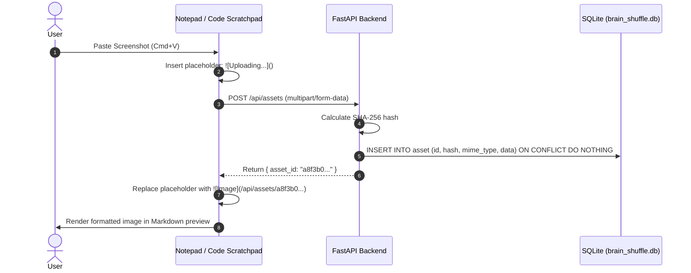
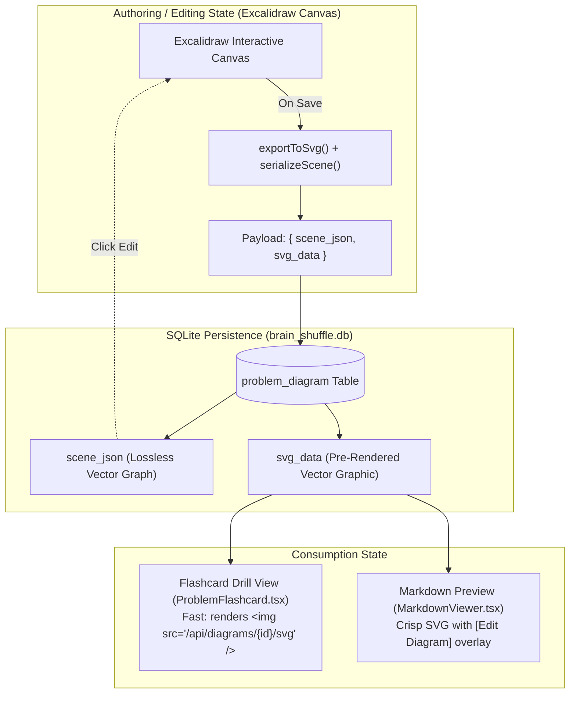
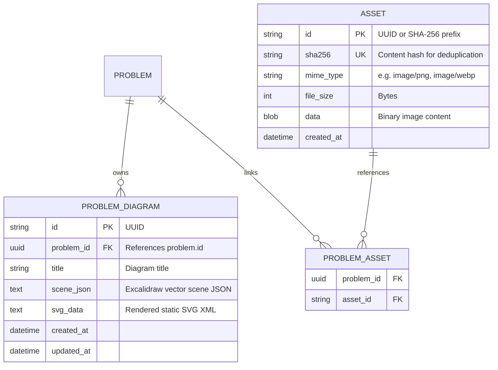

# Diagramming & Asset Architecture Design

## 1) Overview & Objectives

This document specifies the technical design, storage model, third-party tooling evaluation, and UI/UX layouts for two integrated capabilities in BrainShuffle:
1. **Pasted and Dragged Image Support**: Direct clipboard pasting and drag-and-drop ingestion of images and screenshots into problem notes and scratchpads.
2. **Interactive Vector Diagramming**: Freehand architectural and algorithmic diagramming designed for system design, distributed systems, and technical interview preparation.

---

## 2) Third-Party Diagramming Tooling Evaluation

### Tooling Comparison Matrix

| Tooling | Rendering Paradigm | Bundle Footprint | Licensing Model | System Design & Note Suitability |
| :--- | :--- | :--- | :--- | :--- |
| **Excalidraw (`@excalidraw/excalidraw`)** | Infinite vector whiteboard (sketch aesthetic) | ~46 MB unpacked (~2.5 MB minified/gzipped). React 18/19 compatible. | MIT (unrestricted open-source) | **Top Pick**: Native smart arrows with auto-binding, grouping, dark-mode synchronization, lightweight JSON scene graph, and lossless SVG/PNG export. High user familiarity. |
| **tldraw (`@tldraw/tldraw`)** | Infinite vector whiteboard (digital vector aesthetic) | ~2–3 MB minified. Fast-moving API. | Proprietary commercial license for embedded applications; free tier requires attribution watermarks. | Modern UX and canvas extensibility, but licensing restrictions and API churn introduce vendor lock-in and maintenance overhead. |
| **Mermaid.js (`mermaid`)** | Text-to-diagram (declarative code fences in Markdown) | ~1.2 MB minified. Dynamic import supported. | MIT | **Complementary Tool**: Ideal for structured sequence diagrams, state machines, and ERDs defined directly in plain text; cannot handle spatial freehand sketches or whiteboard topology. |
| **Rough.js / Fabric.js (Custom Canvas)** | Custom canvas engine | <150 KB minified. | MIT | Rejected due to high development overhead: requires implementing arrow routing, text auto-wrap, selection matrices, and export pipelines from scratch. |

### Architectural Decision
**`@excalidraw/excalidraw`** is selected as the primary whiteboard and diagramming engine, complemented by text-based **Mermaid.js** rendering in Markdown preview blocks.

---

## 3) Asset Storage Architecture (Clipboard Image Pasting)

### Storage Strategy Evaluation

| Strategy | Storage Location | Backup & Snapshot Impact | Query / Editor Performance | Complexity |
| :--- | :--- | :--- | :--- | :--- |
| **Option A: Inline Base64 Data URI** | Text column in Markdown (`data:image/...`) | Automatically included in problem rows | Severe degradation: 2 MB images inflate database text, slow down list queries, and freeze textareas during typing. | Minimal |
| **Option B: Dedicated SQLite BLOB Table (Selected)** | `asset` table in [data/brain_shuffle.db](data/brain_shuffle.db) | Single-file portability preserved; captured by atomic `VACUUM INTO` snapshots. | Zero editor lag: Markdown stores lightweight URL references (`/api/assets/{id}`). Images streamed via HTTP with caching. | Low-Medium |
| **Option C: Filesystem Directory** | Dedicated folder `data/uploads/{uuid}.png` | High risk: requires multi-file archive backups; snapshots do not capture disk assets. | High raw disk I/O, but introduces orphaned file risks and broken links upon restore. | Medium |

### Clipboard Ingestion Pipeline
1. **Paste Event Interception**: A centralized listener on `<textarea>` and CodeMirror captures `paste` events and inspects `event.clipboardData.items`.
2. **Immediate Optimistic Token**: An optimistic placeholder is inserted at the cursor: ``.
3. **Binary Upload & Hash Deduplication**: The binary payload is transmitted to `POST /api/assets` via `multipart/form-data`. The backend computes a SHA-256 hash of the binary; if identical bytes exist, the existing asset identifier is reused.
4. **Permanent Token Replacement**: The placeholder string is replaced with the canonical Markdown link: ``.



---

## 4) Diagramming Integration Architecture

### Dual-Representation Model

Excalidraw drawings require two distinct representations to balance interactive editing with fast review:
1. `scene_json` (Compressed JSON): The full vector scene graph (`elements`, `appState`, `files`) required by Excalidraw to resume editing without data loss.
2. `svg_data` (XML String): Pre-rendered static vector SVG generated upon save via Excalidraw's `exportToSvg()` utility.



### Bundle Size & Vite Chunking Strategy
- `@excalidraw/excalidraw` is loaded strictly on demand using `React.lazy(() => import("@excalidraw/excalidraw"))`.
- `vite.config.ts` isolates the canvas runtime into a dedicated vendor chunk (`vendor-canvas`), ensuring the default study session bundle remains under 750 KB gzipped.

---

## 5) UI/UX Spatial Design & Layout Paradigms

System architecture diagrams and algorithm traces require substantial horizontal and vertical canvas space. Rendering a canvas within a narrow 300px–450px sidebar causes severe clipping and horizontal scrolling.

### Paradigm 1: 4th Mode in Flashcard Workspace ([ProblemFlashcard.tsx](frontend/src/components/ProblemFlashcard.tsx))
The existing mode bar (`.scratchpad-mode-bar`) is extended to include `Diagram Canvas`:
- **Mode Options**: `Code Only` | `Split View` | `Scratch Notes Only` | `Diagram Canvas`.
- **Canvas Container**: Replaces the split panel with a full-width canvas container (`height: 600px+`) equipped with drawing toolbars, zoom controls, and an "Expand Fullscreen" button.

### Paradigm 2: Full-Screen Zen Overlay with Floating Prompt HUD (Recommended)
Clicking the fullscreen toggle in the canvas opens an expansive 100% viewport modal overlay:
- **Maximum Drawing Space**: Full laptop or monitor screen dedicated to drawing.
- **Collapsible Floating HUD**: Pinned to the top-left corner, displaying the problem title, prompt requirements, cadence, and tags with a collapse/expand toggle.
- **Save & Exit**: Pressing `Esc` or clicking `Save & Exit` commits the scene JSON and SVG to SQLite and returns to the standard workspace.

### Paradigm 3: Dual Notepad Toolbar Integration ([DualNotepad.tsx](frontend/src/components/DualNotepad.tsx))
The quick actions toolbar gains an `Image` button and a `Diagram` button:
- Clicking `Image` opens a native file selector or displays drop zone instructions.
- Clicking `Diagram` launches the Zen Canvas Modal. Saving inserts `` at the cursor.
- In Markdown preview mode, hovering over any rendered diagram reveals a floating `[ Edit Diagram ]` action badge that reopens the canvas with the pre-populated scene.

---

## 6) Database Schema & Relational Specifications



### Table Definitions (SQLite DDL)

```sql
CREATE TABLE IF NOT EXISTS asset (
    id VARCHAR(36) PRIMARY KEY,
    sha256 VARCHAR(64) NOT NULL UNIQUE,
    mime_type VARCHAR(64) NOT NULL,
    file_size INTEGER NOT NULL,
    data BLOB NOT NULL,
    created_at TIMESTAMP DEFAULT CURRENT_TIMESTAMP
);

CREATE TABLE IF NOT EXISTS problem_diagram (
    id VARCHAR(36) PRIMARY KEY,
    problem_id VARCHAR(36) NOT NULL,
    title VARCHAR(255) DEFAULT 'Untitled Diagram',
    scene_json TEXT NOT NULL,
    svg_data TEXT NOT NULL,
    created_at TIMESTAMP DEFAULT CURRENT_TIMESTAMP,
    updated_at TIMESTAMP DEFAULT CURRENT_TIMESTAMP,
    FOREIGN KEY (problem_id) REFERENCES problems(id) ON DELETE CASCADE
);

CREATE INDEX IF NOT EXISTS idx_diagram_problem_id ON problem_diagram(problem_id);
```

---

## 7) Backend API Specifications

### 1. Asset Endpoints
- `POST /api/assets`: Uploads an image binary (`multipart/form-data`). Returns `{ id, url, mime_type, file_size }`.
- `GET /api/assets/{id}`: Streams the binary image with `Content-Type` and `Cache-Control: public, max-age=31536000, immutable`.
- `DELETE /api/assets/{id}`: Removes unreferenced assets (garbage collection).

### 2. Diagram Endpoints
- `POST /api/diagrams`: Creates a new diagram. Body: `{ problem_id, title, scene_json, svg_data }`.
- `GET /api/diagrams/{id}`: Returns the full diagram object including `scene_json` for editing.
- `GET /api/diagrams/{id}/svg`: Directly returns the pre-rendered SVG with `Content-Type: image/svg+xml`.
- `PUT /api/diagrams/{id}`: Updates an existing diagram's `scene_json` and `svg_data`.
- `DELETE /api/diagrams/{id}`: Deletes a diagram record.

---

## 8) Data Portability & Snapshot Guarantee

1. **Atomic Snapshot Integrity**: Because both image binaries (`asset.data`) and diagram vectors (`problem_diagram.scene_json`) are stored within [data/brain_shuffle.db](data/brain_shuffle.db), the native `VACUUM INTO` backup engine in [src/brain_shuffle/services/backup_service.py](src/brain_shuffle/services/backup_service.py) preserves all visual assets without auxiliary filesystem management.
2. **JSON Export & Migration**: The `BackupPayload` schema in [src/brain_shuffle/schemas/backup.py](src/brain_shuffle/schemas/backup.py) can optionally serialize diagram vector JSON and base64-encoded assets for cross-platform migrations.
