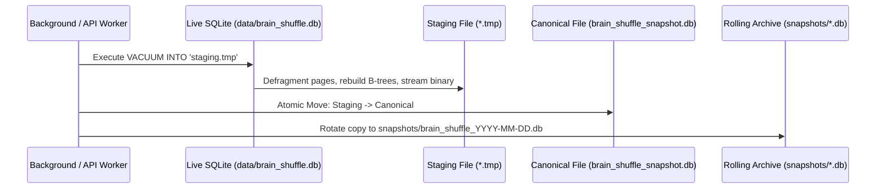
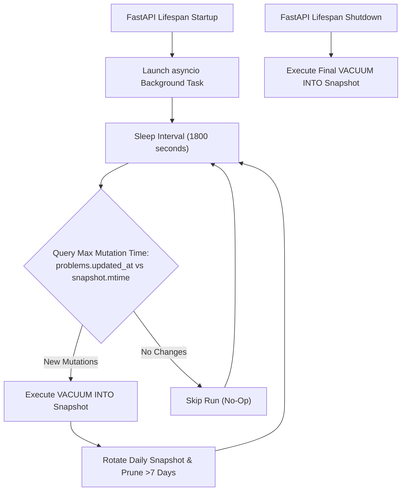
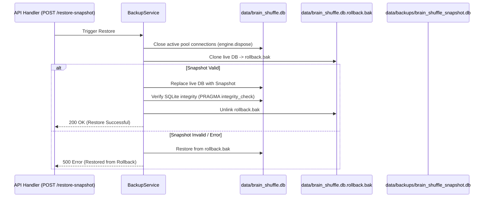

# Technical Specification: Native SQLite Snapshot & Automated Recovery

## 1) Overview & Objectives

This specification defines the native snapshot and automated recovery architecture for Brain Shuffle. The design replaces manual client-side JSON export/import workflows with an in-engine binary snapshot subsystem using SQLite's atomic `VACUUM INTO` command.

The subsystem achieves four technical objectives:
1. **Zero-Overhead Serialization**: Eliminates $O(N)$ JSON serialization and row-by-row parsing overhead by leveraging native database page compaction.
2. **Non-Blocking Concurrency**: Enforces Write-Ahead Logging (WAL) and busy timeout handlers to allow concurrent snapshotting without interrupting user review sessions.
3. **Automated Lifespan Snapshotting**: Runs a background heartbeat worker that tracks write mutations and schedules periodic snapshots, accompanied by graceful shutdown hooks.
4. **Deterministic Storage Contract**: Designates [data/backups/brain_shuffle_snapshot.db](data/backups/brain_shuffle_snapshot.db) as the canonical target for both CLI and GUI recovery operations.

---

## 2) Storage Engine & Concurrency Primitives

### SQLite Pragmas & WAL Configuration
The primary operational database is located at [data/brain_shuffle.db](data/brain_shuffle.db). To maintain zero-lock concurrency during online backup passes, the connection pool in [src/brain_shuffle/db.py](src/brain_shuffle/db.py) applies the following pragmas:

```sql
PRAGMA journal_mode = WAL;
PRAGMA synchronous = NORMAL;
PRAGMA busy_timeout = 5000;
```

### Concurrency Guarantees
- **Readers Do Not Block Writers**: Active card retrieval queries proceed uninterrupted during writes.
- **Writers Do Not Block Readers**: In-flight problem reviews or content edits do not block retrieval queries.
- **Snapshot Isolation**: The `VACUUM INTO` process executes as a read-only transaction against a point-in-time snapshot of database pages, preventing lock starvation.

---

## 3) Native Snapshot Mechanics (`VACUUM INTO`)



### Execution Flow
1. **Target Directory Verification**: The system creates [data/backups/](data/backups/) and [data/backups/snapshots/](data/backups/snapshots/) if not present.
2. **Staging File Generation**: A clean snapshot is created at `data/backups/brain_shuffle_snapshot.db.tmp` via `VACUUM INTO`.
3. **Atomic Swap**: The temporary file replaces the canonical target via `shutil.move` (atomic `rename` on POSIX systems).
4. **Rolling Archive Rotation**: A daily copy is stamped at `data/backups/snapshots/brain_shuffle_YYYY-MM-DD.db`. Files older than 7 days are automatically pruned.

---

## 4) Automated Lifespan Background Worker

The snapshot lifecycle is orchestrated by an asynchronous worker registered inside the FastAPI `lifespan` handler in [src/brain_shuffle/main.py](src/brain_shuffle/main.py):



### Worker Specifications
- **Loop Interval**: 1800 seconds (30 minutes), configurable via `SNAPSHOT_INTERVAL_SECONDS`.
- **Change Detection**: Evaluates `MAX(COALESCE(updated_at, created_at))` across `problems` and `MAX(reviewed_at)` across `review_logs`. If the resulting timestamp $\le$ snapshot modification timestamp, the snapshot is skipped.
- **Process Termination Hook**: Upon receiving `SIGTERM` or `SIGINT`, the lifespan context manager executes a final synchronous snapshot prior to releasing database connections.

---

## 5) Restoration Protocol & Failure Recovery

Restoration overwrites the active database with the contents of the canonical snapshot. To prevent irreversible corruption from ungraceful failures, the protocol implements a three-stage rollback mechanism:



### Safety Requirements
1. **Connection Disposal**: `engine.dispose()` closes idle pool connections prior to file manipulation.
2. **Integrity Verification**: `PRAGMA integrity_check` is executed on the restored file before clearing the rollback buffer.
3. **Rollback Reversion**: If the replacement file fails verification, the active database is restored from `data/brain_shuffle.db.rollback.bak`.

---

## 6) Streamlined Interface & API Specification

### REST API Contracts

| Method | Path | Description | Payload / Response |
| :--- | :--- | :--- | :--- |
| `GET` | `/api/backup/status` | Reports snapshot state and worker status | `{ exists: bool, canonical_path: str, size_bytes: int, last_modified: str, problem_count: int, auto_worker_active: bool }` |
| `POST` | `/api/backup/snapshot-now` | Triggers immediate manual snapshot | `{ status: "success", file_path: str, size_bytes: int }` |
| `POST` | `/api/backup/restore-snapshot` | Restores database from canonical snapshot | `{ status: "success", restored_problems: int }` |
| `GET` | `/api/backup/export` | Secondary JSON export for off-site sharing | `BackupPayload` JSON |
| `POST` | `/api/backup/import` | Secondary JSON import | `{ status: "success", imported_problems: int }` |

### Frontend UI Dashboard
The user interface in [frontend/src/components/BackupManager.tsx](frontend/src/components/BackupManager.tsx) renders:
1. **Status Panel**:
   - Location indicator: `data/backups/brain_shuffle_snapshot.db`
   - Metadata metrics: formatted file size (e.g., `48 KB`), last snapshot timestamp, and problem count.
   - Status badge: green indicator confirming active background auto-snapshotting.
2. **Primary Actions**:
   - **Take Snapshot Now**: Immediate manual execution with loading spinner.
   - **Restore from Snapshot**: Disabled if no snapshot exists. Opens confirmation modal.
3. **Confirmation Modal**:
   - Explicit prompt informing the user of the timestamp of the snapshot to be restored.
   - Requires clicking "Confirm Restore" before triggering the backend mutation.
4. **Collapsible Portability Accordion**:
   - Houses JSON download and upload buttons in a collapsed drawer for optional multi-machine migrations.

---

## 7) CLI & Headless Integration

Administrative workflows in [src/brain_shuffle/cli.py](src/brain_shuffle/cli.py) map directly to the snapshot engine:

```bash
# Execute manual native snapshot to canonical path
uv run brain-shuffle-cli snapshot

# Restore database from canonical snapshot
uv run brain-shuffle-cli restore --snapshot

# Create a snapshot to a custom target path
uv run brain-shuffle-cli snapshot --output /path/to/custom_snapshot.db

# Export portable JSON backup (backwards compatibility)
uv run brain-shuffle-cli dump --output ./data/backups/export.json

# Restore from a portable JSON file
uv run brain-shuffle-cli restore --input ./data/backups/export.json
```
