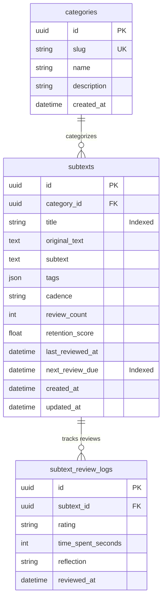
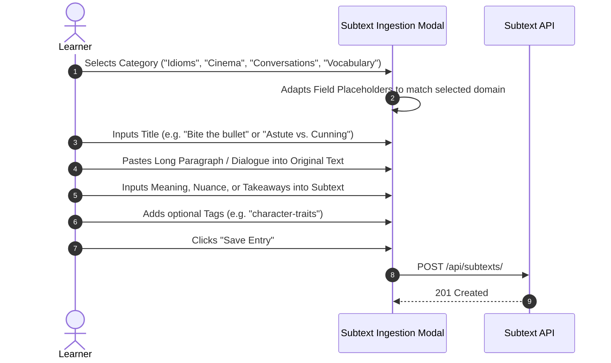
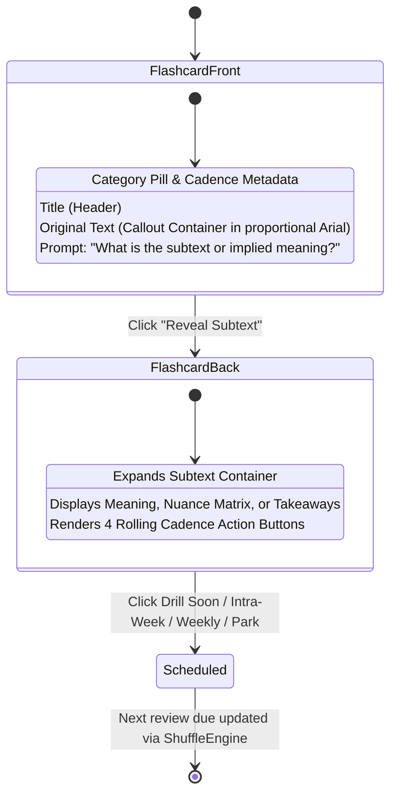
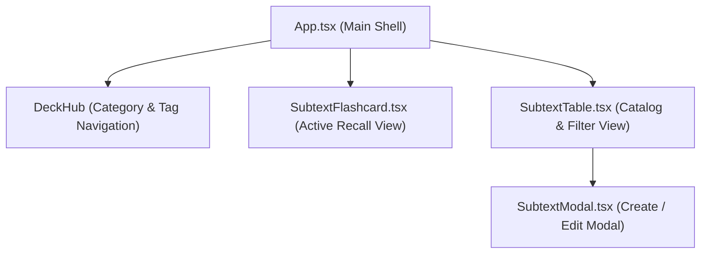

# Subtext Engine & Universal Journaling Architecture

## 1) Vision & Cognitive Foundation

The Subtext subsystem extends the BrainShuffle platform beyond engineering interview drills and technical concepts into language acquisition, cultural literacy, and contextual comprehension.

Traditional vocabulary and reading tools suffer from several limitations:
- **Decontextualized Memorization**: Learning isolated vocabulary definitions without authentic sentence context leads to shallow semantic recall and poor conversational production.
- **Artificial Length Limits**: Most flashcard applications restrict prompt and note fields to short strings, preventing learners from copying and pasting full paragraphs, multi-speaker dialogue scripts, or extended transcripts.
- **Siloed Tooling**: Language learners are forced to separate vocabulary study (single words), idiom practice (phrasal expressions), and critical reading (news analysis, media literacy, cinema quotes) across disparate applications.

### The Subtext Principle
The subsystem resolves these issues by unifying all verbal observations into a single cognitive invariant:

```mermaid
flowchart LR
    subgraph ObservableSurface["Observable Surface (original_text)"]
        O1["Long News Paragraphs"]
        O2["Movie & TV Dialogue"]
        O3["Spoken Dialogue & Social Remarks"]
        O4["Podcast & Audio Transcripts"]
        O5["Idioms & Vocabulary Passages"]
    end

    subgraph CognitiveProcessing["Cognitive Extraction"]
        C1["Title / Anchor: Core term, headline, or thematic cluster"]
    end

    subgraph DecodedInsight["Decoded Insight (subtext)"]
        D1["Definition & Collocations"]
        D2["Unspoken Intention & Reality"]
        D3["Cultural / Comedic Nuance"]
        D4["Synonym Contrast & Intensity Matrix"]
    end

    ObservableSurface --> CognitiveProcessing --> DecodedInsight
```



1. **Surface Layer (`original_text`)**: The verbatim text observed in the world (a copied news paragraph, a movie quote, an audio transcript excerpt, or a set of example sentences).
2. **Anchor Layer (`title`)**: The indexing headline, focal word, or semantic theme.
3. **Deep Layer (`subtext`)**: The decoded meaning, unstated intention, definition, translation, or comparative nuance.

---

## 2) Domain Taxonomy & Use Case Matrix

Four distinct archetypes map onto the identical 3-field content structure (`title`, `original_text`, `subtext`):

| Archetype | Description | `title` | `original_text` | `subtext` |
| :--- | :--- | :--- | :--- | :--- |
| **1. Atomic Idioms & Words** | Single words, phrasal verbs, or idioms learned in native context. | Target expression (e.g. `Bite the bullet`). | Full copied reading excerpt or news paragraph containing the term. | Definition, literal vs. figurative distinction, collocations. |
| **2. Semantic & Synonym Clusters** | Thematic groups describing a single concept or personality trait. | Thematic concept (e.g. `Personality: Astute vs. Cunning`). | Comparative sentence list demonstrating 3–5 related terms in action. | Nuance matrix, spectrum of intensity, positive vs. pejorative connotations. |
| **3. Cinema & Audio Transcripts** | Parsing subtext in movie scripts, podcasts, and speeches. | Context label (e.g. *Good Will Hunting: Bar Scene*). | Verbatim dialogue transcript or speaker quote. | Subtext: Power dynamic, hidden emotional stakes, comedic irony. |
| **4. Conversational Diplomacy & News** | Decoding euphemisms, corporate spin, and public statements. | Topic headline (e.g. *Corporate Bandwidth Realignment*). | Company memo or diplomatic release paragraph. | The unspoken reality: Layoffs, budget constraints, or policy shifts. |

---

## 3) Database Architecture & Schema Specification

The subsystem utilizes the existing SQLite relational engine ([src/brain_shuffle/db.py](src/brain_shuffle/db.py)) configured with Write-Ahead Logging (WAL mode). Unbounded `TEXT` columns accommodate multi-page excerpts and scripts without truncation.

### 3.1 Entity Relationship Diagram



### 3.2 SQL DDL Specification: `subtexts`

```sql
CREATE TABLE subtexts (
    id CHAR(32) NOT NULL,
    category_id CHAR(32) NOT NULL,
    title VARCHAR(256) NOT NULL,
    original_text TEXT NOT NULL,
    subtext TEXT NOT NULL,
    tags JSON DEFAULT '[]',
    cadence VARCHAR(32) DEFAULT 'weekly',
    review_count INTEGER DEFAULT 0,
    retention_score FLOAT DEFAULT 1.0,
    last_reviewed_at DATETIME,
    next_review_due DATETIME,
    created_at DATETIME NOT NULL,
    updated_at DATETIME NOT NULL,
    PRIMARY KEY (id),
    FOREIGN KEY(category_id) REFERENCES categories (id)
);

CREATE INDEX ix_subtexts_title ON subtexts (title);
CREATE INDEX ix_subtexts_category_id ON subtexts (category_id);
CREATE INDEX ix_subtexts_next_review_due ON subtexts (next_review_due);
```

### 3.3 Field Dictionary

- `id`: `UUID` primary key.
- `category_id`: Foreign key referencing [src/brain_shuffle/models/category.py](src/brain_shuffle/models/category.py).
- `title`: Short indexing string (word, idiom, headline, or cluster theme). Maximum 256 characters. Indexed.
- `original_text`: Unbounded `TEXT` container storing copied paragraphs, multi-speaker dialogue scripts, or comparative sentence lists.
- `subtext`: Unbounded `TEXT` container storing definition, underlying intent, cultural nuance, or contrastive notes.
- `tags`: `JSON` array of string tags for cross-cutting themes (e.g. `["cinema", "negotiation", "character"]`).
- `cadence`: Rolling schedule tier (`daily`, `intra_week`, `weekly`, `monthly`). Default `'weekly'`.
- `review_count`: Total review executions.
- `retention_score`: Adaptive multiplier tracking retention strength.
- `next_review_due`: Indexed timestamp calculated by the rolling schedule engine.
- `created_at` / `updated_at`: UTC timestamps.

---

## 4) Ingestion & Authoring Workflow

### 4.1 Ingestion Modal Layout

The creation modal provides a focused 3-field input experience with dynamic placeholder adaptation:



### 4.2 Dynamic Placeholder Guidance

| Selected Category | `title` Placeholder | `original_text` Placeholder | `subtext` Placeholder |
| :--- | :--- | :--- | :--- |
| `Idioms` | *e.g. Bite the bullet* | *Paste the paragraph or sentence where the idiom occurred...* | *Literal origin vs. figurative meaning and collocations...* |
| `Vocabulary` | *e.g. Ephemeral* | *Paste the reading passage demonstrating authentic usage...* | *Definition, register (formal/literary), and synonyms...* |
| `Cinema & TV` | *e.g. Good Will Hunting (Bar Scene)* | *Paste dialogue transcript or speaker quotes...* | *The unspoken subtext, comedic irony, or emotional stakes...* |
| `Conversations` | *e.g. Negotiation Pushback* | *Paste what was spoken verbatim...* | *The underlying agenda, boundary, or political subtext...* |

---

## 5) Active Recall & Flashcard Interaction Lifecycle



### Interaction Rules
1. **Front Face**: Displays the `title` and quotes the `original_text` within a styled callout container. The code editor is hidden, ensuring full vertical area for paragraph reading.
2. **Back Face**: Reveals the `subtext` section formatted in proportional Arial typography (`var(--font-notes)` at `13px`–`14px`, `line-height: 1.5`).
3. **Cadence Action Row**: Features standard 4 triage buttons:
   - `Drill Soon`: ~4 hours (daily reinforcement).
   - `Intra-Week`: 2–3 days (consolidation).
   - `Weekly`: 7 days (standard maintenance).
   - `Park`: 21 days (mastered item).

---

## 6) API Contract Specification

| Method | Endpoint | Description |
| :--- | :--- | :--- |
| `POST` | `/api/subtexts/` | Create a new subtext entry. Accepts `category_id`, `title`, `original_text`, `subtext`, `tags`, `cadence`. |
| `GET` | `/api/subtexts/` | Retrieve paginated entries with filters for `category_id`, `tag`, and full-text keyword search `query`. |
| `GET` | `/api/subtexts/{id}` | Fetch a single entry with complete paragraph text and review logs. |
| `PUT` | `/api/subtexts/{id}` | Update title, original text, subtext, tags, or category. |
| `DELETE` | `/api/subtexts/{id}` | Delete entry and cascade deletion of review logs. |
| `POST` | `/api/subtexts/{id}/review` | Record review triage rating; calculates `next_review_due` via `resolve_cadence_schedule`. |

---

## 7) Frontend Architecture & Component Decomposition



- **`SubtextFlashcard.tsx`**: Specialized card component rendering proportional typography, quote containers for long text, reveal toggles, and cadence triage controls.
- **`SubtextModal.tsx`**: Lightweight 3-field modal with multi-line textareas supporting tab indentation.
- **`DeckHub` Integration**: Category chips in the existing top navigation seamlessly filter between technical problem decks (`Coding`, `System Design`) and subtext decks (`Idioms`, `Cinema`, `Conversations`, `Vocabulary`).

---

## 8) Implementation Roadmap & Milestones

1. **Milestone 1 — Data Layer**:
   - Create SQLModel class `Subtext` and `SubtextReviewLog` in `src/brain_shuffle/models/subtext.py`.
   - Register models in `src/brain_shuffle/models/__init__.py`.
   - Update `init_db()` in [src/brain_shuffle/db.py](src/brain_shuffle/db.py).
2. **Milestone 2 — API Endpoints**:
   - Implement router `src/brain_shuffle/api/subtexts.py` with CRUD and review handlers.
   - Register router in `src/brain_shuffle/main.py`.
   - Add unit tests in `tests/test_subtexts.py`.
3. **Milestone 3 — Frontend UI & Cards**:
   - Add TypeScript interfaces in [frontend/src/types.ts](frontend/src/types.ts).
   - Create `SubtextFlashcard.tsx` and `SubtextModal.tsx`.
   - Integrate into Deck Hub category filtering and active shuffle rotation.
