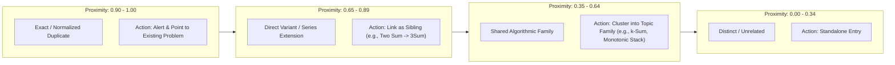
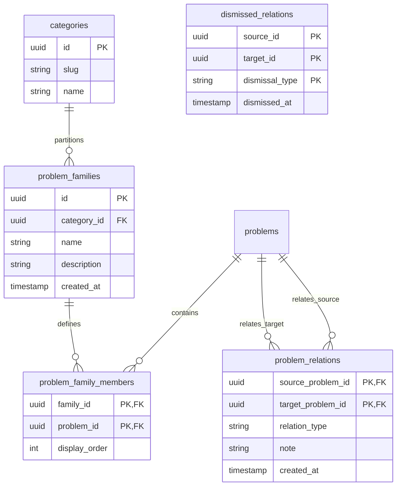
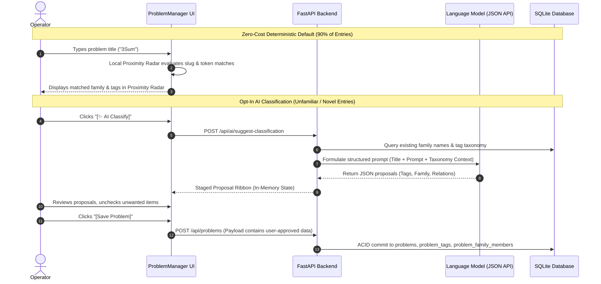

# Topic Grouping, Deduplication & Classification Design

## 1) Overview & Objectives

As a problem catalog expands, two challenges arise:
1. **Unintentional Duplication**: Multiple entries are created for the same concept or problem under slightly different titles, casing, or word orders (e.g., `LRU Cache` vs. `Implement LRU Cache in Python`).
2. **Topic Dispersion**: Related problems and variants (e.g., `Two Sum`, `3Sum`, `4Sum`, or `Two Sum II - Input Array Is Sorted`) remain isolated, preventing operators from retrieving or reviewing them together in targeted study sessions.

This document specifies the technical design, data structures, UI/UX interaction workflows, and human-in-the-loop (HITL) advisory architecture to resolve both challenges.

---

## 2) The Unified Semantic Proximity Spectrum

Duplication detection and topic grouping represent adjacent zones on a single **Semantic Proximity Spectrum**:



By evaluating candidate inputs against this continuous spectrum, a unified engine distinguishes true duplicates from deliberate variants without redundant processing.

---

## 3) Zero-Cost Client-Side Proximity Radar (Real-Time As-You-Type)

To maintain zero network latency and $0.00 operational cost, duplicate detection and variant identification run client-side in the browser using the problem inventory already held in memory.

### 3.1 Proximity Radar Interface ([ProblemManager.tsx](frontend/src/components/ProblemManager.tsx))
Mounted immediately beneath the `Problem Title` input in the creation dialog:

```
+----------------------------------------------------------------------------------------------------+
| Problem Title: [ 3Sum                                                            ] [✨ AI Classify] |
+----------------------------------------------------------------------------------------------------+
| 📡 Proximity Radar:                                                                                |
|                                                                                                    |
|  🟡 Related Sibling Detected (Proximity: 78%):                                                     |
|     "Two Sum" (Coding | 4 reviews | Retention: 95% | Cadence: Weekly)                              |
|     [👉 View Existing Problem]  [🔗 Link as Sibling to "Two Sum"]                                   |
|                                                                                                    |
|  📁 Detected Topic Family:                                                                        |
|     [✓ Add to family: "k-Sum Series" (Contains: Two Sum, 4Sum)]                                    |
|                                                                                                    |
|  🏷️ Suggested Tags from Taxonomy:                                                                  |
|     [+ two-pointers]  [+ sorting]  [+ array]                                                       |
+----------------------------------------------------------------------------------------------------+
```

### 3.2 High-Probability Duplicate Alert
When the proximity score reaches $\ge 0.90$ (e.g., typing `LRU Cache in Python` when `LRU Cache` exists):

```
+----------------------------------------------------------------------------------------------------+
| Problem Title: [ LRU Cache in Python                                             ]                 |
+----------------------------------------------------------------------------------------------------+
| 📡 Proximity Radar:                                                                                |
|                                                                                                    |
|  🔴 Potential Duplicate Detected (Proximity: 94%):                                                 |
|     "LRU Cache" (Coding | 6 reviews | Last reviewed: 3d ago | Retention: 92%)                      |
|     Prompt: "Implement LRU Cache with O(1) get and put operations using Doubly Linked List..."     |
|                                                                                                    |
|     [👉 Open Existing Entry to Edit / Review]                                                      |
|     [📝 Append New Solution Note to Existing Entry]                                                |
|     [⚠️ Dismiss & Create Separate Entry Anyway]                                                    |
+----------------------------------------------------------------------------------------------------+
```

### 3.3 Heuristic Scoring Pipeline
The client evaluates candidates against active problems using a weighted composite function:

$$\text{CompositeScore} = 0.50 \cdot S_{\text{Jaccard}} + 0.30 \cdot S_{\text{Levenshtein}} + 0.20 \cdot S_{\text{SeriesMatch}}$$

1. **Normalized Canonical Slug**:
   - Lowercase transformation.
   - Punctuation and symbol stripping (`?`, `-`, `:`, `_`).
   - Stop-word removal (`"the"`, `"a"`, `"an"`, `"in"`, `"using"`).
2. **Token Set Jaccard ($S_{\text{Jaccard}}$)**:
   - Measures bag-of-words set intersection over union. Catches word reordering (e.g., `Top K Frequent Elements` vs. `K Most Frequent Elements`) with $S_{\text{Jaccard}} = 1.0$.
3. **Series & Suffix Parser ($S_{\text{SeriesMatch}}$)**:
   - Evaluates regular expressions for Roman numerals (`I`, `II`, `III`, `IV`), cardinal numbers (`2`, `3`), and constraint clauses (`- Sorted Array`, `(Hard)`):
     ```python
     VARIANT_REGEX = r"^(?P<base>.*?)(?:\s+(?:[0-9]+|I{1,3}|IV|V|VI{0,3}))?(?:\s*[-–:]\s*(?P<qualifier>.*))?$"
     ```
   - When the parsed `base` matches an existing problem, the system suppresses duplicate alerts and recommends linking the item as a **Variant** under `{base} Series`.
4. **Static Domain Alias Table**:
   - A client dictionary maps standard algorithmic aliases (e.g., `Dutch National Flag` $\leftrightarrow$ `Sort Colors`, `Floyd's Cycle` $\leftrightarrow$ `Linked List Cycle II`, `Circular Tour` $\leftrightarrow$ `Gas Station`).

---

## 4) Structural Taxonomy & Topic Family Data Model

Unstructured comma-separated tag strings lead to vocabulary fragmentation (`two-pointer`, `two-pointers`, `2-pointer`). The system introduces normalized relational models:



### Table Definitions

```sql
-- Topic families representing study clusters (e.g. "k-Sum Series")
CREATE TABLE IF NOT EXISTS problem_families (
    id TEXT PRIMARY KEY,
    category_id TEXT NOT NULL,
    name TEXT NOT NULL,
    description TEXT,
    created_at TIMESTAMP DEFAULT CURRENT_TIMESTAMP,
    FOREIGN KEY (category_id) REFERENCES categories(id) ON DELETE CASCADE
);

CREATE TABLE IF NOT EXISTS problem_family_members (
    family_id TEXT NOT NULL,
    problem_id TEXT NOT NULL,
    display_order INTEGER NOT NULL DEFAULT 0,
    PRIMARY KEY (family_id, problem_id),
    FOREIGN KEY (family_id) REFERENCES problem_families(id) ON DELETE CASCADE,
    FOREIGN KEY (problem_id) REFERENCES problems(id) ON DELETE CASCADE
);

-- Explicit inter-problem relationships
CREATE TABLE IF NOT EXISTS problem_relations (
    source_problem_id TEXT NOT NULL,
    target_problem_id TEXT NOT NULL,
    relation_type TEXT NOT NULL, -- 'variant', 'prerequisite', 'extension', 'see_also'
    note TEXT,
    created_at TIMESTAMP DEFAULT CURRENT_TIMESTAMP,
    PRIMARY KEY (source_problem_id, target_problem_id),
    FOREIGN KEY (source_problem_id) REFERENCES problems(id) ON DELETE CASCADE,
    FOREIGN KEY (target_problem_id) REFERENCES problems(id) ON DELETE CASCADE
);

-- Rejection tracking to prevent dismissed suggestions from reappearing
CREATE TABLE IF NOT EXISTS dismissed_relations (
    source_id TEXT NOT NULL,
    target_id TEXT NOT NULL,
    dismissal_type TEXT NOT NULL, -- 'relation', 'family'
    dismissed_at TIMESTAMP DEFAULT CURRENT_TIMESTAMP,
    PRIMARY KEY (source_id, target_id, dismissal_type)
);
```

---

## 5) Retrieval & Review Workflows

### 5.1 Retrieval: Family-Clustered Table View ([ProblemManager.tsx](frontend/src/components/ProblemManager.tsx))
A view mode selector switches between a flat problem list and a structured **Topic Family View**:

```
[ View: By Category | By Topic Family | By Cadence ]

▼ 📁 k-Sum Series (3 problems)                         [⚡ Drill Family (3)] [+ Add to Family]
  ├── 1. Two Sum                      | Easy | Cadence: Weekly     | Last: 2d ago | [Edit] [Review]
  ├── 2. 3Sum                         | Med  | Cadence: Intra-week | Last: 5d ago | [Edit] [Review]
  └── 3. 4Sum                         | Med  | Cadence: Monthly    | Last: Never  | [Edit] [Review]

▼ 📁 Monotonic Stack Pattern (3 problems)              [⚡ Drill Family (3)] [+ Add to Family]
  ├── 1. Next Greater Element I       | Easy | Cadence: Weekly     | Last: 1w ago | [Edit] [Review]
  ├── 2. Daily Temperatures           | Med  | Cadence: Weekly     | Last: 3d ago | [Edit] [Review]
  └── 3. Largest Rectangle in Hist... | Hard | Cadence: Intra-day  | Last: 4h ago | [Edit] [Review]

► 📄 Standalone / Unclustered Problems (14 problems)
```

### 5.2 Review: In-Flashcard Sibling HUD ([ProblemFlashcard.tsx](frontend/src/components/ProblemFlashcard.tsx))
During active recall sessions, cards with assigned relations surface a sibling navigation bar:

```
+----------------------------------------------------------------------------------------------------+
|  Coding Flashcard  •  Topic Family: k-Sum Series                                     [ 2 of 5 ]    |
+----------------------------------------------------------------------------------------------------+
|                                                                                                    |
|  Problem: 3Sum                                                                                     |
|  Given an integer array nums, return all triplets [nums[i], nums[j], nums[k]] summing to 0.        |
|                                                                                                    |
|  🔗 Related Context:                                                                               |
|     [ 💡 Compare with: Two Sum ]    [ ➡️ Next in Series: 4Sum ]                                    |
|                                                                                                    |
+----------------------------------------------------------------------------------------------------+
|  [ Reveal Solution Notes ]                                                                         |
+----------------------------------------------------------------------------------------------------+
```

Clicking `[ 💡 Compare with: Two Sum ]` slides open a side panel rendering the core notes of `Two Sum` without terminating or resetting the current active test session.

### 5.3 Review: Targeted Family Drill Decks
Clicking `[⚡ Drill Family]` compiles a targeted active recall session:
- Reuses the existing `ReviewList` and `review_list_problems` engine.
- **Interleaver Override**: While the general shuffle engine in [src/brain_shuffle/services/shuffle_engine.py](src/brain_shuffle/services/shuffle_engine.py) applies an anti-clustering penalty to randomize topics, **Targeted Family Drill Decks** explicitly disable this penalty. This allows consecutive testing of related algorithmic variations (`Two Sum` $\to$ `3Sum` $\to$ `4Sum`).

---

## 6) Surgical Human-in-the-Loop (HITL) AI Integration

To protect data integrity and avoid unnecessary API token expenditure, the system enforces a strict advisory boundary:



### 6.1 Guiding Constraints
1. **Zero Automated Mutations**: The LLM never writes directly to SQLite. Proposals are staged transiently in client-side component state.
2. **Explicit Opt-In Trigger**: Ingestion does not call external APIs automatically; classification assistance requires an explicit button click (`[✨ AI Classify]`).
3. **Context Minimization**: Prompts transmit only `title`, `prompt` (first 120 characters), and existing taxonomy labels. Code solutions, execution traces, and binary assets are excluded.
4. **Suppression Tracking (`dismissed_relations`)**: When an operator rejects a proposed link, the rejection is recorded in `dismissed_relations`. The backend filters suppressed associations before presenting future recommendations.

---

## 7) Batch Pattern Discovery (On-Demand Maintenance)

For grouping unclustered problems retrospectively, the system provides an on-demand batch clustering workflow:

1. **Trigger**: Initiated from the curation toolbar (`[✨ Discover Algorithmic Patterns]`).
2. **Ingestion**: The backend selects up to 30 problems lacking family assignments.
3. **Pattern Induction**: The LLM identifies shared algorithmic patterns and outputs proposed family groupings.
4. **Staging Review Drawer**: Results are presented in an interactive drawer with checkboxes and editable title fields:
   ```
   [✓] Proposed Family: "Monotonic Stack Pattern"                       [Rename] [Dismiss]
       [✓] Next Greater Element I
       [✓] Daily Temperatures
       [✓] Largest Rectangle in Histogram
       [ ] Trapping Rain Water (Unchecked by user -> two-pointer preferred)
   ```
5. **Commit**: Clicking `[Apply Approved Patterns]` writes the approved groupings to `problem_families` and `problem_family_members` within a single atomic database transaction.

---

## 8) Comparative Architecture Matrix

| Dimension | Pure Lexical Heuristics | Pure Automated LLM Pipeline | Proposed Hybrid Architecture |
| :--- | :--- | :--- | :--- |
| **Operational Cost** | **$0.00** | Token-metered on all inputs | **$0.00 baseline**; micro-cost only on explicit click |
| **Detection Latency** | **<5ms (As-you-type)** | 400–1500ms API latency | **<5ms client radar**; async on user request |
| **Series Awareness** (`I` vs. `II`) | Regex parses suffixes | High contextual understanding | **Optimal**: Regex detects series; LLM resolves semantics |
| **False-Positive Handling** | May miss disjoint synonyms | May hallucinate false associations | **Optimal**: Local radar catches 90%; strict HITL gates writes |
| **Study Flow Integration** | Flat tag lists | Generic grouping | **Integrated**: Family accordion, sibling HUD, drill decks |
| **Data Safety** | High (local rules) | Low (uncontrolled mutations) | **Absolute**: In-memory staging with ACID commit |
