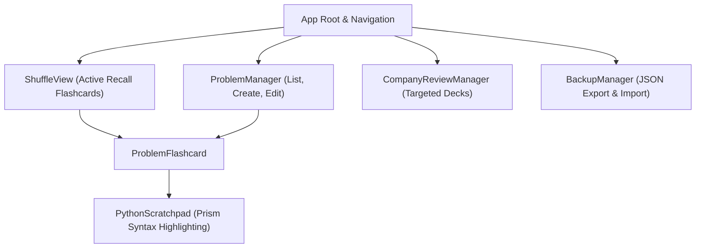

# Brain Shuffle Frontend

Single-page web interface for Brain Shuffle, built with React, TypeScript, and Vite.

## 1) Overview

The frontend delivers an active recall flashcard interface, a problem organizer with in-place modal editing, a company review list manager, and a data portability portal.



---

## 2) Component Architecture

- [src/components/ProblemFlashcard.tsx](src/components/ProblemFlashcard.tsx):
  - Renders problem titles initially while keeping active recall prompts and solutions hidden.
  - Houses the synchronized Python code block scratchpad.
  - Provides progressive disclosure buttons for problem details and solutions.
  - Features the compact, low-saturation rolling cadence action row (`Drill Soon`, `Mid-Week`, `Next Week`, `Skip / Park`).
- [src/components/PythonScratchpad.tsx](src/components/PythonScratchpad.tsx):
  - Synchronizes a transparent textarea overlay with a Prism.js Python syntax-highlighting layer and a line-numbered gutter.
  - Implements 4-space Tab indent, Shift+Tab dedent, Enter auto-indent with colon detection, and paired bracket auto-closing.
  - Persists ephemeral draft code per problem in `sessionStorage` (`session_scratch_{problemId}`).
- [src/components/ProblemManager.tsx](src/components/ProblemManager.tsx):
  - Problem titles list with category pills, company badges, and expanded embedded flashcards.
  - Modal dialogs for problem creation and editing with 900px wide layouts, non-dismissive backdrops, 2-column form rows, and 12-row monospace reference notes editors.
- [src/components/CompanyReviewManager.tsx](src/components/CompanyReviewManager.tsx):
  - Company problem breakdown across coding, system design, and AI domains.
  - Multi-select problem checklist for creating persistent custom review lists.
- [src/components/ShuffleView.tsx](src/components/ShuffleView.tsx):
  - Weighted queue shuffle manager filtering by domain category, company, or target review list.
- [src/components/BackupManager.tsx](src/components/BackupManager.tsx):
  - Downloadable JSON exports and file-upload restore interface.

---

## 3) Development & Build

### Development Server
```bash
npm install
npm run dev
```
The development server starts by default at `http://localhost:5173` with Vite Hot Module Replacement (HMR).

### Production Build
```bash
npm run build
```
Executes TypeScript type checking (`tsc -b`) and generates production assets in `dist/`.
