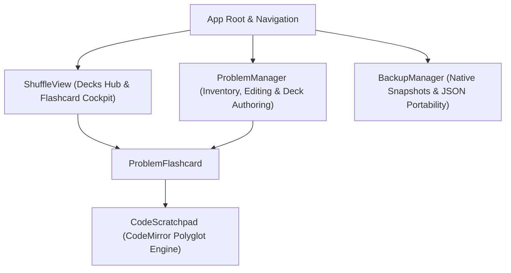

# BrainShuffle Frontend

Single-page web interface for BrainShuffle, built with React, TypeScript, and Vite.

## 1) Overview

The frontend delivers an active recall flashcard interface, a problem organizer with in-place modal editing and multi-select deck authoring, and a data persistence portal.



---

## 2) Component Architecture

- [src/components/ProblemFlashcard.tsx](src/components/ProblemFlashcard.tsx):
  - Renders problem titles initially while keeping active recall prompts and solutions hidden.
  - Houses the embedded multi-language code scratchpad and dual notes workspace.
  - Provides progressive disclosure buttons for problem details and solutions.
  - Features the compact, low-saturation rolling cadence action row (`Drill Soon`, `Mid-Week`, `Next Week`, `Skip / Park`).
- [src/components/CodeScratchpad.tsx](src/components/CodeScratchpad.tsx):
  - Integrates CodeMirror 6 with syntax grammar engines for Python 3, TypeScript, JavaScript, C++, Java, Go, Rust, SQL, JSON, and Plain Text / Shell.
  - Supports persistent language selection in `localStorage` (`preferred_scratchpad_language`).
  - AST-aware bracket matching, indentation, and multiline comments/docstrings.
  - Implements 4-space Tab indent and dedent via `@codemirror/commands` and `@codemirror/language`.
  - Persists ephemeral draft code per problem in `sessionStorage` (`session_scratch_{problemId}`).
  - Includes smooth vertical height resizer (180px–820px) persisting to `localStorage` (`preferred_scratchpad_height`).
- [src/components/ProblemManager.tsx](src/components/ProblemManager.tsx):
  - Curate domain: problem inventory with category pills, company badges, search, and embedded flashcards.
  - Multi-select row checklist with "Select All Visible" toggle for creating persistent review decks (`createReviewList`).
  - Modal dialogs for problem creation and editing with 900px wide layouts, non-dismissive backdrops, 2-column form rows, and 12-row monospace reference notes editors.
- [src/components/ShuffleView.tsx](src/components/ShuffleView.tsx):
  - Study domain: Decks Hub with Company Loops, Coding Tracks, System Design Tracks, and Custom Saved Decks with direct deletion.
  - Active test room with bidirectional navigation, card flipping, topic interleaving, and rolling cadence review logs.
- [src/components/BackupManager.tsx](src/components/BackupManager.tsx):
  - Preserve domain: Native SQLite snapshots (`VACUUM INTO`), live telemetry, modal-guarded recovery, and JSON portability.

---

## 3) Development & Build

### Development Server
```bash
npm install
npm run dev
```
The development server starts by default at `http://localhost:5173` with Vite Hot Module Replacement (HMR).

### Production Build
```bash
npm run build
```
Executes TypeScript type checking (`tsc -b`) and generates production assets in `dist/`.
